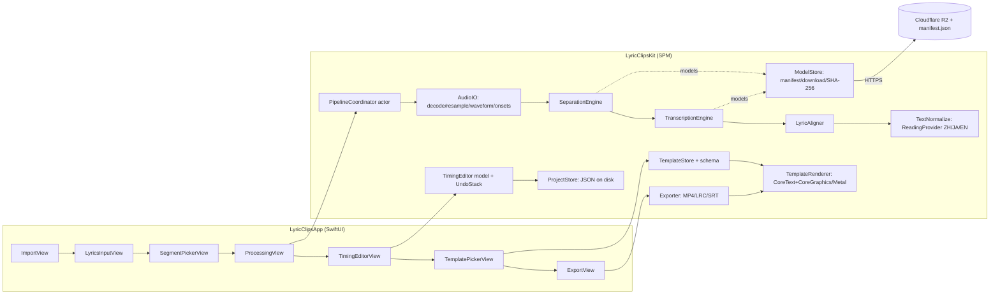
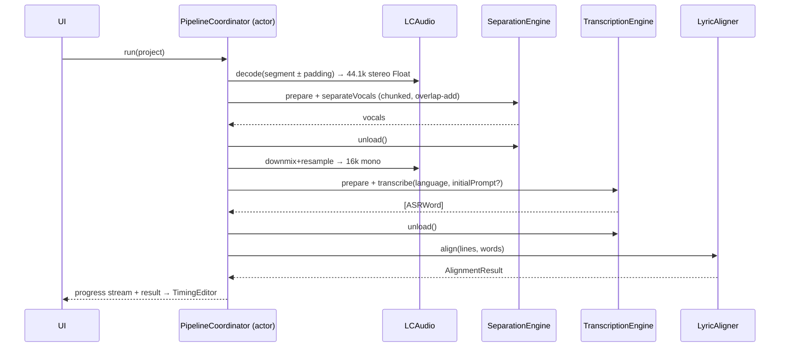

# SCG LyricClips — iOS MVP 开发框架与规格书（v0.1）
> 工作名 `SCG LyricClips`（正式名待定）｜所有者：株式会社SCG Creation / SCG Audio｜起草：2026-11-17（JST）｜实施方：Codex
> 竞品参考：Plastic 的 Clips。本文是 Codex 的唯一权威规格；与本文冲突的实现一律以本文为准，规格有歧义时在 PR 描述里提出，不要自行发挥。
> 标记约定：✅ 已查证（附链接）｜⚠️ 未查证 / 需在 Phase 0 实测｜⛔ 阻塞上架，未解决前不得发布。

## 0. 一页摘要
- 免费 iOS App：导入歌曲 → 粘贴歌词 → 在设备上分离人声并对齐歌词 → 手动修正时间 → 选 15–60 s 片段 → 套模板 → 导出 1080×1920 MP4 + LRC/SRT。
- 目的是为 SCG Audio 引流和建立品牌：模板带克制的 “Made with SCG Audio” 署名，邮箱订阅可选、不强制。
- 全部本地处理，不上传歌曲，不用云端推理。只处理用户选中的片段（前后各加 1 s padding）。
- 技术栈：SwiftUI（iOS 17+），Core ML，whisper.cpp（Core ML encoder），AVFoundation（AVAssetWriter），不用 FFmpeg，不用 x264。
- **重要发现 ⛔：Demucs/HTDemucs 的预训练权重不是 MIT，作者明确说只限研究用途**（见 §9）。所以分离引擎必须可替换，Phase 0 要同时验证“Spleeter 2stems”和“不分离直接识别”两条路线。
- 先做 1 周技术 spike（Phase 0），再做 iOS MVP（约 6–8 周）。Android 以后再做。

## 1. 目标 / 非目标
**目标（MVP）**
- G1 导入：Files（`fileImporter`）和音乐库里本地、无 DRM 的曲目（`MPMediaItem.assetURL != nil`）。支持 mp3/m4a/aac/wav/aiff/flac（以 AVFoundation 能解码为准）。
- G2 粘贴歌词（ZH 简/繁、JA、EN，允许混排），按行拆分，空行作为段落分隔。
- G3 在波形上选 15–60 s 片段；只对片段 ±1 s 做分离和识别。
- G4 自动对齐到**行级**时间（每行 start/end），给出逐行置信度。
- G5 时间编辑器（MVP 核心）：逐行拖动、微调、tap-to-sync、撤销/重做。
- G6 3–5 个模板，预览和导出用同一个渲染器（所见即所得）。
- G7 导出 MP4（H.264 默认，HEVC 可选）+ LRC + SRT，用系统分享面板保存或分享。
- G8 UI 本地化：ja、zh-Hans、zh-Hant、en。
**非目标（MVP 不做）**
- 云端处理、账号体系、上传歌曲、社交 feed、内购或广告。
- 字级卡拉 OK 动画、振假名、竖排、双语字幕、可视化、批量、背景视频、DAW 联动、ASS 导出（都放到 Phase 7+）。
- 流媒体（Apple Music/Spotify）音源，DRM 内容一律不支持。
- iPad 专用布局（可以运行，但不做专门优化）。

## 2. 平台与最低机型
- 最低系统 **iOS 17.0**。iOS 17 的 Core ML 支持 `MLModel.compileModel(at:)` 异步编译和 ML Program。注意：Apple 托管的 Background Assets 需要 iOS 26，所以模型分发不依赖它（见 §8）。
- 最低机型 **A14 / iPhone 12 系列（4 GB RAM）**，理由如下：
  - HTDemucs Core ML 版峰值内存约 1 GB，只能跑 CPU（ANE 不稳定，会回退）✅ [HF: mlboydaisuke/HTDemucs-CoreML](https://huggingface.co/mlboydaisuke/HTDemucs-CoreML)、[dexxdean/htdemucs-coreml](https://github.com/dexxdean/htdemucs-coreml)。再加上 whisper small 一级模型，4 GB 机型是下限。
  - A12/A13（XS/11）同样有 4 GB，但 CPU 和 ANE 都更慢，预计 30 s 片段超过 2 分钟 ⚠️。
  - 判定方式：用 `utsname.machine` 白名单加启动时自检（`os_proc_available_memory()` 小于 1.2 GB 时降级），不在 Info.plist 里硬性限制机型。低于 A14 的机器可以安装，但只开放“手动 tap-to-sync”模式（见 §7 降级）。
- ⚠️ `com.apple.developer.kernel.increased-memory-limit` entitlement 可以放宽 jetsam 上限（[zenn 介绍](https://zenn.dev/mtfum/articles/ios_memory_entitlements?locale=en)）。MVP 先申请，但设计上必须按“不依赖它”来做内存预算。

## 3. 总体架构

- **分层原则**：`Core` 层是纯 Swift，只依赖 Foundation，Linux 上也能 `swift test`（Codex cloud 环境是 Linux，无法跑 Xcode）。Apple 专属层放 Core ML、AVFoundation、whisper、SwiftUI，只在 macOS/Xcode 上编译。
- 所有引擎都通过 protocol 注入（见 §5），所以能替换实现（Spleeter、Passthrough、将来的自训模型或 Android 版）。

## 4. 仓库与 SPM 布局
```
scg-lyricclips/
  AGENTS.md                     # Codex 工作规则
  DEV_SPEC.md                   # 本文件
  App/LyricClips.xcodeproj      # 只有 App target，代码尽量放进 Kit
  App/LyricClips/               # @main, AppDelegate, Assets, Localizable.xcstrings, PrivacyInfo.xcprivacy
  Packages/LyricClipsKit/Package.swift
    Sources/
      LCCore/          # 纯 Swift：数据模型、Project schema、错误类型、时间工具     (Linux OK)
      LCText/          # 纯 Swift：归一化、ReadingProvider 协议、Levenshtein/对齐算法 (Linux OK)
      LCAlign/         # 纯 Swift：LyricAligner 实现、置信度、行时间推导         (Linux OK)
      LCTiming/        # 纯 Swift：TimingEditor 模型、UndoStack、tap-sync 逻辑     (Linux OK)
      LCTemplates/     # 纯 Swift：Template JSON schema、校验、布局计算（不含绘制）(Linux OK)
      LCSubtitles/     # 纯 Swift：LRC/SRT 编解码                                  (Linux OK)
      LCModelStore/    # 纯 Swift 部分：manifest 解析、SHA-256 校验（swift-crypto）、版本选择 (Linux OK)
      LCAppleText/     # Apple：JA MeCab/IPADic、ZH CFStringTransform、CFStringTokenizer
      LCAudio/         # Apple：AVAudioFile 解码、重采样（AVAudioConverter）、波形、onset
      LCSeparation/    # Apple：SeparationEngine 各实现（CoreML Spleeter / HTDemucs(dev only) / Passthrough）
      LCTranscription/ # Apple：whisper.cpp 封装（binaryTarget xcframework，WHISPER_COREML=1）
      LCRender/        # Apple：TemplateRenderer（CoreText+CoreGraphics，后续 Metal）
      LCExport/        # Apple：AVAssetWriter MP4 导出
      LCPipeline/      # Apple：PipelineCoordinator actor、进度、取消、内存/热状态守护
      LCUI/            # SwiftUI 功能视图（可在 App 内 Preview）
    Tests/  (每个 target 一个 XCTest / Swift Testing target；Fixtures/ 放测试数据)
  tools/
    convert/           # Python：coremltools 转换脚本（Spleeter→CoreML、whisper encoder 生成）
    manifest/          # Python：生成 models manifest.json + SHA-256
    bench/             # 设备 benchmark 场景说明与结果 CSV
  docs/THIRD_PARTY_NOTICES.md, docs/MODEL_PROVENANCE.md, docs/bench-results/
```
- 依赖：whisper.cpp（MIT，官方 xcframework 已支持 Core ML ✅ [PR #2912](https://github.com/ggerganov/whisper.cpp/pull/2912)）、Mecab-Swift + IPADic（⚠️ 许可证见 §9）、swift-crypto（Apache-2.0，Linux 上用；Apple 上用 CryptoKit）。**禁止**引入 FFmpeg、x264、任何 GPL/AGPL 依赖和任何 analytics SDK。
- Bundle ID 占位 `jp.scgcreation.lyricclips`，Team 由 Umi 提供。

## 5. 模块与协议（可替换引擎）
```swift
// LCCore
public struct TimeRange: Codable, Hashable, Sendable { public var start: Double; public var end: Double } // 秒，相对原曲 0 点
public struct PipelineProgress: Sendable { public var stage: Stage; public var fraction: Double; public enum Stage: String, Sendable { case decode, separate, transcribe, align, render, export } }
public struct AudioBuffer: Sendable { public var sampleRate: Double; public var channels: [[Float]] } // 非交错 PCM

// LCSeparation
public protocol SeparationEngine: Sendable {
  var id: String { get }                    // "spleeter-2stems-coreml-v1" / "passthrough" / "htdemucs-dev"
  var requiredModels: [ModelID] { get }
  func prepare(store: ModelStore) async throws          // 加载/编译模型，可重复调用
  func separateVocals(_ input: AudioBuffer, progress: @Sendable (Double) -> Void) async throws -> AudioBuffer // 返回 vocals（mono 16k 或原采样率由实现声明）
  func unload() async                                     // 释放内存，Pipeline 在切换阶段时调用
}
// LCTranscription
public struct ASRWord: Codable, Sendable { public var text: String; public var start: Double; public var end: Double; public var prob: Float }
public struct TranscriptionOptions: Sendable { public var language: LyricLanguage; public var initialPrompt: String?; public var useDTWTimestamps: Bool }
public protocol TranscriptionEngine: Sendable {
  var id: String { get }
  var requiredModels: [ModelID] { get }
  func prepare(store: ModelStore) async throws
  func transcribe(_ vocals16kMono: [Float], offset: Double, options: TranscriptionOptions, progress: @Sendable (Double) -> Void) async throws -> [ASRWord]
  func unload() async
}
// LCText
public protocol ReadingProvider: Sendable { func units(for text: String, language: LyricLanguage) -> [ReadingUnit] }
public struct ReadingUnit: Hashable, Sendable { public var key: String; public var sourceRange: Range<Int> } // key 例：EN 小写字母串、JA 平假名一拍、ZH 无调拼音音节
// LCAlign
public protocol LyricAligner: Sendable { func align(lines: [LyricLine], words: [ASRWord], segment: Segment, language: LyricLanguage) throws -> AlignmentResult }
public struct AlignmentResult: Sendable { public var lines: [LyricLine]; public var overallConfidence: Double; public var suggestedLineRange: Range<Int> }
// LCTiming
public protocol TimingEditor { var lines: [LyricLine] { get }; mutating func apply(_ edit: TimingEdit) throws; mutating func undo(); mutating func redo(); var canUndo: Bool { get }; var canRedo: Bool { get } }
public enum TimingEdit: Equatable { case setStart(lineID: UUID, Double), setEnd(lineID: UUID, Double), nudge(lineID: UUID, delta: Double), shiftAll(delta: Double), tapSync(lineID: UUID, at: Double), split(lineID: UUID, at: Int), merge(UUID, UUID), editText(UUID, String) }
// LCRender
public protocol TemplateRenderer { func prepare(template: Template, project: Project) throws; func renderFrame(at time: Double, into pixelBuffer: CVPixelBuffer) throws } // Apple 专属
// LCExport
public protocol Exporter { func export(project: Project, template: Template, settings: ExportSettings, progress: @Sendable (Double) -> Void) async throws -> ExportArtifacts }
// LCModelStore
public protocol ModelStore: Sendable {
  func status(_ id: ModelID) async -> ModelStatus      // .notDownloaded / .downloading(Double) / .ready(URL) / .corrupt
  func ensure(_ ids: [ModelID], allowCellular: Bool, progress: @Sendable (Double) -> Void) async throws -> [ModelID: URL]
  func purge(_ id: ModelID) async throws
  var totalBytesOnDisk: Int64 { get async }
}
```
- 实现清单（MVP）：`SpleeterCoreMLSeparationEngine`（候选默认）、`PassthroughSeparationEngine`（不分离，只做 mono 下混和 16 kHz 重采样）、`HTDemucsCoreMLSeparationEngine`（**只能在 DEBUG 编译**，用 `#if DEBUG` 加编译开关强制，Release 不得链接）、`WhisperCppTranscriptionEngine`、`NWLyricAligner`（semi-global Needleman-Wunsch）、`CoreGraphicsTemplateRenderer`、`AVAssetWriterExporter`、`R2ModelStore`。
- 依赖注入：`EngineRegistry` 读 Remote Config（manifest 里的 `defaults` 字段）选默认引擎，所以不用发版就能切换。

## 6. 数据模型
```swift
public enum LyricLanguage: String, Codable, Sendable { case zhHans = "zh-Hans", zhHant = "zh-Hant", ja, en, mixed }
public struct Project: Codable, Identifiable, Sendable {
  public static let schemaVersion = 1
  public var schemaVersion: Int; public var id: UUID; public var createdAt: Date; public var updatedAt: Date
  public var title: String; public var artist: String?
  public var audio: AudioSource          // 沙盒内拷贝的相对路径 + 时长 + 采样率 + 原文件名
  public var language: LyricLanguage
  public var rawLyrics: String           // 用户原文，永不修改
  public var lines: [LyricLine]
  public var segment: Segment
  public var templateID: String; public var templateOverrides: TemplateOverrides?
  public var processing: ProcessingInfo? // 引擎 id、模型版本、耗时、整体置信度（用于 bench 与 bug 报告）
}
public struct AudioSource: Codable, Sendable { public var relativePath: String; public var duration: Double; public var sampleRate: Double; public var originalFilename: String }
public struct Segment: Codable, Sendable { public var range: TimeRange; public var padding: Double = 1.0 // 15...60 s，校验在 init
}
public struct LyricLine: Codable, Identifiable, Sendable {
  public var id: UUID; public var index: Int; public var text: String
  public var translation: String?        // Phase 7 双语
  public var start: Double?; public var end: Double?   // nil = 未定时
  public var confidence: Double          // 0...1，手动修改后置 1 并且 source = .manual
  public var source: TimingSource        // .auto / .interpolated / .manual / .tapSync
  public var words: [WordTiming]         // MVP 可以为空；Phase 7 字级卡拉 OK 使用
  public var isInSegment: Bool
}
public struct WordTiming: Codable, Sendable { public var text: String; public var range: Range<Int>; public var start: Double; public var end: Double; public var reading: String? }
public enum TimingSource: String, Codable, Sendable { case auto, interpolated, manual, tapSync }
```
- 存储：`Application Support/Projects/<uuid>/project.json` + `audio.<ext>`（导入时拷贝）+ `cache/vocals.caf`（可删，删了就重新计算）。JSON 用 `.iso8601` 日期和 `sortedKeys`，方便做 golden 比较。
- 迁移：`schemaVersion` 递增时写 `ProjectMigrator`，有对应单测。
- 时间统一用**秒（Double）**，以原曲 0 点为基准，显示和导出时再减去 `segment.start`。

## 7. 处理流水线

**步骤细节**
1. **解码**：用 `AVAudioFile` 只读片段 ±1 s（`framePosition` seek），不解码整首歌。输出 44.1 kHz stereo Float32。
2. **分离**：按模型固定窗口切块（HTDemucs 是 7.8 s / 343980 samples，Spleeter 由转换时决定），25% overlap，用 Hann 窗做 overlap-add。块与块之间检查 `Task.checkCancellation()` 并上报进度。
3. **识别**：whisper.cpp，**显式指定语言**（不要自动检测）；开 DTW token timestamps（`whisper_context_params.dtw_token_timestamps = true` 加对应的 `dtw_aheads_preset`，✅ [whisper.h](https://github.com/ggml-org/whisper.cpp/blob/master/include/whisper.h)、[PR #1485](https://github.com/ggml-org/whisper.cpp/pull/1485)），取 token 的 `t_dtw` 拼成词。旧方式 `max_len=1` 只作对比基线（官方标为 experimental ✅ [README](https://github.com/ggml-org/whisper.cpp)）。Core ML 只加速 encoder，decoder 仍要 ggml 权重 ✅ [whisper.swiftui README](https://github.com/ggml-org/whisper.cpp/blob/master/examples/whisper.swiftui/README.md)。⚠️ 首次在设备上加载 Core ML encoder 时 ANE 编译很慢，要显示“首次准备中”，并在模型下载完成后后台预热一次。
   - `initialPrompt`：把片段对应的歌词前 ~200 tokens 作为 prompt，能把词汇往正确方向拉，但可能加重“幻觉”。Phase 0 要做 A/B，结果写入 bench。
   - 模型候选：`ggml-base`（~142 MB）、`ggml-small-q5_1`（⚠️ 约 180 MB）、`ggml-small`（~466 MB）。只用多语言版，不用 `.en` 版。由 spike 决定默认值。
4. **对齐**（`NWLyricAligner`，纯 Swift，可以在 Linux 上测）：
   - a) 归一化：全角转半角，去掉标点和括号内的注释（如 “(x2)”、“（コーラス）”），统一大小写。ZH 繁转简不是必须的，因为比较的是拼音。
   - b) 转成读音单元 `ReadingUnit`：EN 用字母串，以词为单位；JA 先经 MeCab 拿到读音，片假名转平假名，长音和小字归一，按拍（mora）切分；ZH 用 `CFStringTransform(kCFStringTransformMandarinLatin)` 再去声调，按音节切分（系统自带，无许可证问题 ⚠️ 多音字准确率要实测）；混合语言按字符所属文字（script）逐段选择 provider。
   - c) ASR 词同样转成单元，词的时间按单元数在内部平均分配。
   - d) **semi-global** 对齐：歌词一侧两端空位免费，因为用户粘贴的是整首歌，而片段只覆盖其中几行。代价为：匹配 0；相似替换（拼音声母或韵母相同、假名同一行或同一段、编辑距离 ≤1）0.5；替换 1；空位 1。复杂度 O(n·m)，60 s 片段的 n、m 都在 1k 以内，能接受。
   - e) 行时间：start 取该行第一个匹配单元的 start，end 取最后一个匹配单元的 end。完全没匹配上的行，按前后已定时行和字数做线性插值，并标 `.interpolated`。保证单调：start(i) ≥ end(i-1) - 0.05。
   - f) 置信度：行置信度 = 匹配单元比例 × 平均相似度；整体置信度 = 按字数加权的平均值。`suggestedLineRange` 是落在片段内的连续行。
   - g) 重复副歌：semi-global 对齐会选代价最低的位置。如果有多个近似最优解（代价差 < 5%），把歧义交给用户选“这是第几次副歌”。
5. **进入编辑器**：置信度 < 0.5 的行标黄；整体置信度 < 0.6 时弹出提示“自动对齐不太准，推荐用 tap-to-sync”。

**线程、内存、取消、进度**
- `PipelineCoordinator` 是 actor，一次只跑一个 project。重活放在 `Task.detached(priority: .userInitiated)`，UI 通过 `AsyncStream<PipelineProgress>` 订阅进度。
- **同一时刻只常驻一个大模型**：分离结束必须先 `unload()` 再加载 whisper。峰值内存目标 ≤ 1.3 GB（⚠️ spike 实测）。每个阶段开始前检查 `os_proc_available_memory()`，不够就抛 `.insufficientMemory`，走降级路线。
- 进度权重：decode 5%、separate 45%、transcribe 40%、align 10%（spike 后再校准）。
- 取消：UI 的取消按钮调用 `task.cancel()`，引擎在每个 chunk 或 whisper 的 `abort_callback` 里响应，500 ms 内要返回，并清理临时文件。
- 热状态：监听 `ProcessInfo.thermalStateDidChangeNotification`；到 `.serious` 时降低线程数，到 `.critical` 时暂停并提示。
- 后台：MVP 要求处理时 App 在前台。切到后台时用 `beginBackgroundTask` 争取时间收尾，超时就保存进度并标记为可恢复。⚠️ iOS 26 的 `BGContinuedProcessingTask` 以后再评估。
- 缓存：结果以 `hash(audio, segment, engineID, modelVersion)` 为 key 缓存 vocals 和 ASR 词。只改歌词时不需要重新分离和识别，只重跑对齐。

**错误与降级**
| 情况 | 处理 |
|---|---|
| 机型低于 A14 或可用内存 < 1.2 GB | 跳过分离，用 `Passthrough` 加 whisper base；还不行就只开放 tap-to-sync 手动模式 |
| 模型未下载或下载失败 | 显示大小和网络类型，可以重试；蜂窝网络需要用户确认；SHA-256 不符就删掉重下（最多 3 次） |
| 识别结果为空或几乎为空（纯器乐、说唱太快） | 提示后直接进入 tap-to-sync |
| 整体置信度 < 0.6 | 进入编辑器，顶部横幅推荐 tap-to-sync，低置信度的行标黄 |
| DRM 或无法解码 | 导入时就拦截，提示“请使用你拥有权利且无 DRM 的音频文件” |
| 存储空间不足 | 导出前检查（`volumeAvailableCapacityForImportantUsage`）是否 ≥ 预估大小 × 2 |
| 取消或 App 被杀 | project.json 每个阶段结束都落盘，重新打开时可以从上个阶段继续 |
- 错误类型统一为 `LCError: LocalizedError`（`code` 稳定，方便用户反馈时报告）。不接入崩溃上报 SDK，用 Apple 自带的 Xcode Organizer 看崩溃。

## 8. 模型分发（ModelStore）
**方案对比与决定**
| 方案 | 优点 | 缺点 | 结论 |
|---|---|---|---|
| Cloudflare R2 + 自定义 manifest | iOS 17 就能用；能切换版本、做 A/B、回滚；Android 也能复用；R2 出口流量免费 | 要自己做下载、校验和断点续传 | **MVP 采用** |
| Hugging Face 直链 | 零成本 | 受第三方可用性和限速影响，也不好控制版本 | 只作镜像或备用 |
| On-Demand Resources | 系统托管 | **iOS 27 起已弃用** ✅ [Apple](https://developer.apple.com/help/app-store-connect/reference/app-uploads/on-demand-resources-size-limits/) | 不用 |
| Apple-Hosted Background Assets | Apple 托管，最大 200 GB | 需要 iOS 26+ ✅ [WWDC25](https://developer.apple.com/videos/play/wwdc2025/325/) | 等最低系统 ≥ 26 时再迁移 |
- 下载：`URLSession` background configuration，支持断点续传（resume data）。下载完先写到 `Application Support/Models/<id>/<version>/` 的临时文件，SHA-256 校验通过后再原子 rename。目录设 `isExcludedFromBackup = true`。
- Core ML 模型以 `.mlpackage.zip` 分发，下载后用 `MLModel.compileModel(at:)` 编译，把 `.mlmodelc` 缓存起来，模型版本变化时重新编译。
- manifest（`https://models.scgaudio.example/lyricclips/manifest.v1.json`，域名占位）：
```json
{"schema":1,"updatedAt":"2026-11-17T00:00:00Z","minAppVersion":"1.0.0",
 "defaults":{"separation":"spleeter-2stems-coreml","transcription":"whisper-small-q5_1"},
 "models":[{"id":"whisper-small-q5_1","version":"1","kind":"ggml","url":"https://.../ggml-small-q5_1.bin","bytes":190000000,"sha256":"<hex>",
   "companions":[{"id":"whisper-small-encoder-coreml","url":"https://.../ggml-small-encoder.mlmodelc.zip","bytes":0,"sha256":"<hex>"}],
   "license":"MIT","sourceURL":"https://github.com/openai/whisper","provenance":"verified"}]}
```
- manifest 本身要签名或固定 hash：MVP 只走 HTTPS 并对每个文件做 SHA-256 校验。⚠️ 以后可加 Ed25519 签名（公钥内置在 App 里）。
- 设置页显示“已下载模型 xx MB，可删除”。

## 9. 许可证与模型来源（⛔ 上架前必须全部是 ✅）
| 组件 | 用途 | 代码许可 | 权重/数据许可 | 状态 |
|---|---|---|---|---|
| whisper.cpp | ASR 运行时 | MIT ✅ | — | ✅ |
| OpenAI Whisper 权重（ggml 转换版） | ASR | MIT ✅ | MIT（openai/whisper 仓库说明代码和权重都是 MIT）⚠️ 发版前再确认一次 | ⚠️ |
| Whisper Core ML encoder（我们自己用 `generate-coreml-model.sh` 生成） | ASR 加速 | MIT 衍生 | 同上 | ⚠️ |
| Demucs / HTDemucs | 人声分离 | MIT ✅ | **不是 MIT，作者说只限研究用途** ✅ [issue #327](https://github.com/facebookresearch/demucs/issues/327)、[#508](https://github.com/facebookresearch/demucs/issues/508)、[adefossez README](https://github.com/adefossez/demucs)。HF 上标“MIT”的 Core ML 转换版不能作为依据 | ⛔ **只能用于 DEBUG 和 benchmark** |
| Spleeter 2stems | 人声分离（候选默认） | MIT ✅ | JOSS 论文写明“source code and pre-trained models … MIT” ✅ [paper.md](https://github.com/deezer/spleeter/blob/master/paper.md)，但 README 只写代码是 MIT，相关 issue 仍然开着 [#898](https://github.com/deezer/spleeter/issues/898)、[#957](https://github.com/deezer/spleeter/issues/957) | ⚠️ 建议 Umi 以公司名义向 Deezer 要书面确认 |
| Open-Unmix umxhq | 分离 | MIT | 只用 MUSDB18-HQ 训练 → 避免 | ❌ 不用 |
| Meta MMS / UVR / MDX-Net / RoFormer 社区权重 | — | — | CC-BY-NC 或来源不明 | ❌ 不用 |
| MeCab | JA 分词 | GPL/LGPL/BSD 三选一，**选 BSD** ⚠️ | — | ⚠️ |
| IPADic | JA 词典 | — | IPADic 自有许可（宽松，要保留声明）⚠️ | ⚠️ |
| Mecab-Swift（[shinjukunian](https://github.com/shinjukunian/Mecab-Swift)） | Swift 封装，内含 IPADic ✅ | ⚠️ 许可证待查 | — | ⚠️ |
| Apple CFStringTransform / CFStringTokenizer | ZH 拼音、JA 兜底 | 系统 API | — | ✅ |
| 字体 | 模板 | MVP 用系统字体（Hiragino Sans、PingFang SC/TC、SF）⚠️ 把系统字体渲染进视频是否合规需要确认；备选是下载 OFL 的 Noto Sans/Serif CJK | — | ⚠️ |
- 交付物：`docs/THIRD_PARTY_NOTICES.md`、`docs/MODEL_PROVENANCE.md`（每个模型写明来源 URL、commit 或文件 hash、训练数据、许可、核实人和日期），App 内“设置 → 第三方许可”页面显示同样的内容。
- CI 检查：Release 配置下如果链接了 `HTDemucs*` 或者 manifest 里出现 `provenance != "verified"` 的默认模型，构建失败。
- **分离路线决策树（Phase 0 输出）**：① Spleeter 2stems Core ML 能转换成功，并且对齐准确率比不分离明显更好 → 默认用 Spleeter（等书面确认）；② 不分离的准确率已经够用（与①差距 < 5 个百分点）→ MVP 不分离，省下 70 MB 以上下载和约 45% 的耗时；③ 两者都不行 → 评估商业授权（AudioShake / Music.AI 等，⚠️ 未询价），或者用自有、授权干净的数据自训练（成本高，放到 Phase 8+）。

## 10. 时间编辑器（MVP 核心）
- 布局：上方是片段波形（显示 vocals stem，没有就显示原混音）加播放头；下方是歌词行列表，每行显示 start、end 和置信度色点。
- 操作：
  - 点一行，从 `start - 0.5 s` 开始播放。
  - 在波形上拖动行块的左右边缘调整时间，吸附到 onset（能量突变点，±80 ms 内），按住时临时关闭吸附。
  - 微调按钮：±10 ms、±50 ms、±100 ms，长按连续调整。
  - 全局偏移滑块：±2 s。
  - 拆分和合并行，修改行文字（只改显示，`rawLyrics` 不动）。
- **Tap-to-sync 模式**：从片段起点播放，可选 0.5×、0.75×、1× 速度（`AVAudioUnitTimePitch`，不变调）；每点一下屏幕，就把当前行 start 设为当前时间，同时设定上一行的 end；双击是“这一行结束、后面是空白”。点击时间要补偿 `outputLatency`，并加用户可调的反应时间（默认 -80 ms ⚠️ 需要测）。
- 撤销/重做：`UndoStack` 至少保留 100 步，每个手势结束算一步。
- 规则：手动改过的行设 `source = .manual`、`confidence = 1`；重新跑对齐时**不覆盖**手动行，只更新 `.auto` 和 `.interpolated` 的行。
- 播放：`AVAudioEngine` 加 `AVAudioPlayerNode`，用 `lastRenderTime` 算出精确的播放时间，UI 用 `TimelineView(.animation)` 刷新。

## 11. 模板系统
- 模板 = 一个 JSON 文件加可选资源（背景图），放在 App bundle 的 `Templates/<id>/template.json`。以后可以通过 manifest 远程下发新模板（不含代码）。
- 渲染：`CoreGraphicsTemplateRenderer` 先用纯函数 `LayoutEngine` 算出每帧的绘制指令（在 LCTemplates 里，Linux 上可测），再用 CoreText + CoreGraphics 把这些指令画进 `CVPixelBuffer`。预览和导出调用同一个 `renderFrame(at:)`，预览用 `MTKView` 或 `CALayer` 显示，保证所见即所得。**不用** `AVVideoCompositionCoreAnimationTool`，因为它无法在 AVPlayer 预览里直接复用，也很难做逐帧的 golden 测试。
- 安全区：TikTok、Reels 的界面会盖住顶部约 8%、底部约 20%、右侧约 12%（⚠️ 估计值，要在三个平台上截图核实），歌词必须放在 `safeArea` 里。
- MVP 模板（5 个）：`minimal-center`（单行居中淡入淡出）、`two-line-next`（当前行加下一行半透明）、`typewriter`（逐字出现，按行时间平均分配）、`big-bold-pop`（大号粗体弹出）、`artwork-blur`（专辑封面模糊背景，没有封面就用渐变）。
- JSON Schema（`schema: 1`，有 `TemplateValidator` 单测）：
```json
{"schema":1,"id":"two-line-next","version":"1.0.0","name":{"ja":"2行","zh-Hans":"双行","zh-Hant":"雙行","en":"Two Lines"},
 "canvas":{"width":1080,"height":1920,"fps":30},
 "safeArea":{"top":0.08,"bottom":0.20,"left":0.06,"right":0.12},
 "background":{"type":"gradient","colors":["#0E0E12","#2A1E3A"],"angle":160,"image":null,"blur":0},
 "text":{"fontFamilies":{"ja":["HiraginoSans-W6"],"zh-Hans":["PingFangSC-Semibold"],"zh-Hant":["PingFangTC-Semibold"],"en":["SFProDisplay-Bold"]},
   "size":72,"minSize":44,"color":"#FFFFFF","stroke":{"color":"#000000","width":0},"shadow":{"color":"#00000080","radius":12,"x":0,"y":4},
   "align":"center","maxLines":3,"lineSpacing":1.2,"autoShrink":true},
 "layout":{"mode":"currentAndNext","anchor":{"x":0.5,"y":0.55},"nextLine":{"opacity":0.45,"scale":0.8,"gap":36}},
 "animation":{"in":{"type":"fadeUp","durationMs":220,"easing":"easeOut"},"out":{"type":"fade","durationMs":160},"highlight":{"type":"none"}},
 "credit":{"text":"Made with SCG Audio","position":"bottomCenter","opacity":0.55,"size":28,"defaultOn":true,"userRemovable":true},
 "extensions":{}}
```
- 枚举值：`background.type` 取 `solid|gradient|image|artworkBlur`；`layout.mode` 取 `single|currentAndNext|scroll`；`animation.in.type` 取 `none|fade|fadeUp|pop|typewriter`；`highlight.type` 在 MVP 只有 `none`，Phase 7 加 `lineWipe` 和 `karaoke`。不认识的字段忽略，不认识的枚举值回退到默认并记 warning。
- 换行：CJK 按字断行并遵守禁则（`kCTLineBreakByWordWrapping` 加 CoreText 的语言属性）；EN 按词断行。超出 `maxLines` 时先 `autoShrink` 到 `minSize`，还放不下就截断并在编辑器里提示。
- 署名：默认开启，用户可以关闭（详见 §17 Q3）。署名不得遮挡歌词，不能做成闪烁或动画。

## 12. 导出规格
| 项 | 值 |
|---|---|
| 容器 | MP4（`.mp4`），`shouldOptimizeForNetworkUse = true`（moov 前置） |
| 视频 | 1080×1920，30 fps（可选 60），H.264 High Profile，约 10 Mbps（30 fps）或 16 Mbps（60 fps），关键帧间隔 2 s；可选 HEVC Main 约 6 Mbps（⚠️ 部分平台会二次转码，默认用 H.264），色彩空间 BT.709 |
| 音频 | AAC-LC，48 kHz，立体声，256 kbps；裁剪到片段，首尾各加 30 ms 淡入淡出避免爆音 |
| 时长 | 等于片段长度（15–60 s），可选再加 1.5 s 片尾卡（Logo + 署名，默认关） |
| 实现 | `AVAssetWriter` + `AVAssetWriterInputPixelBufferAdaptor`（像素格式 `kCVPixelFormatType_32BGRA`，用 pixel buffer pool）；音频用 `AVAssetReader` 读出片段 PCM 后写入；使用系统硬件编码器 |
| 性能目标 | 30 s 视频在 iPhone 12 上 ≤ 20 s 导出完 ⚠️ |
| LRC | UTF-8 无 BOM，`[ti:]` `[ar:]` `[by:SCG LyricClips]` 头；每行 `[mm:ss.xx]文本`（百分之一秒），时间相对片段起点；可选“相对原曲”模式 |
| SRT | UTF-8，序号从 1 开始，`HH:MM:SS,mmm --> HH:MM:SS,mmm`，end 取该行 end（为空时取下一行 start - 0.05 s，最多 start + 5 s），条目之间空一行，CRLF 或 LF 都接受（输出 LF） |
| 文件名 | `<title>_<yyyyMMdd-HHmm>.mp4/.lrc/.srt`，替换掉非法字符 |
| 分享 | `ShareLink` / `UIActivityViewController`；保存到相册用 `PHPhotoLibrary`（只申请 add-only 权限 `NSPhotoLibraryAddUsageDescription`） |
- 以后（Phase 7+）：ASS 导出（带样式和卡拉 OK `\k` 标签）、透明背景 ProRes 4444（给剪辑软件用）。

## 13. 隐私、条款、App Store
- **隐私**：音频、歌词和生成结果都只在本机，不上传。网络只用于下载模型和模板 manifest（请求里不带用户数据）。MVP 不接入任何 analytics 或广告 SDK。
- **邮箱订阅**：MVP 不在 App 内收集邮箱。第一次导出成功后，显示一张可以关掉的卡片“关注 SCG Audio / 订阅 newsletter”，点击后用 `SFSafariViewController` 打开 SCG Audio 的订阅网页。这样 App 隐私标签可以填“不收集数据”。
- **条款**：首次使用时显示，必须点“同意”才能继续。要点：只处理你拥有权利或已获授权的音乐；你对导出内容在各平台的使用负责；SCG 不接收你的音频。另外有日文、中文、英文的隐私政策 URL（App Store Connect 必填）。
- **Privacy Manifest**（`PrivacyInfo.xcprivacy`）：`NSPrivacyTracking = false`；`NSPrivacyCollectedDataTypes = []`；Required Reason API 至少声明 UserDefaults（`CA92.1`）、File timestamp（`C617.1`）、Disk space（`E174.1`，用于导出前检查空间）⚠️ 用到的 API 要逐项核对，第三方 SDK（whisper.cpp、MeCab）也要检查。
- **App Store 注意**：
  - 安装包 < 100 MB（不内置模型，IPADic 约 50 MB ⚠️ 要量；太大的话改成下载）。
  - 首次下载模型前要说明大小，蜂窝网络下需要确认。
  - 审核备注写明“所有处理都在本地，模型从我们的 CDN 下载、只是数据不是代码”，避免被当成下载可执行代码（Guideline 2.5.2）。
  - 示例素材只用 SCG Audio 自有曲目，不能出现第三方版权歌曲（截图和审核演示视频也一样）。
  - 年龄分级 4+；出口合规：只用标准 HTTPS，`ITSAppUsesNonExemptEncryption = false`。
- 音乐库导入需要 `NSAppleMusicUsageDescription`；`assetURL == nil`（DRM 或仅云端）的曲目置灰并说明原因。

## 14. 测试策略
- **单元测试（Linux 能跑，Codex 主战场）**：
  - `LCText`：归一化、假名转换、拼音去声调、Levenshtein，测试读音用 fixture 里预先算好的结果（Linux 上没有 MeCab 和 CFStringTransform，用 `FixtureReadingProvider`）。
  - `LCAlign`：fixture 在 `Tests/Fixtures/align/{zh,ja,en,mixed}/case-*.json`，包含 `lyrics`、`asrWords`（模拟值，加入替换、漏词、多词、时间抖动）和 `expectedLineStarts`（允许误差 ±0.15 s）。场景至少有：完全匹配；ASR 错 30% 的字；片段只覆盖中间 4 行；副歌重复 3 次；整行漏识别（要插值）；ASR 输出繁体而歌词是简体；日文里夹英文；空 ASR 结果。
  - `LCTiming`：每种 edit、undo/redo、单调性约束、手动行不被覆盖。
  - `LCSubtitles`：LRC/SRT 往返测试和 golden 文件；边界情况包括 59.995 s 进位、超过 1 小时、空行。
  - `LCTemplates`：5 个内置模板都能通过 schema 校验；不认识的字段能容忍；`LayoutEngine` 在给定时间输出的绘制指令和 golden JSON 一致。
  - `LCModelStore`：manifest 解析、版本选择、SHA-256 不符时的处理（用 mock URLProtocol）。
- **Apple 侧测试（Mac 加模拟器或真机，Umi 本地跑，或用 Codex CLI 在 Mac 上跑）**：
  - Golden 渲染：每个模板取 t ∈ {0.0, 0.5, 1.2, 末帧} 渲染 PNG，和 `Tests/Golden/render/*.png` 对比（每像素容差 ≤ 2/255，差异像素 < 0.5%）。字体相关的 golden 按系统大版本分开存放。
  - 导出：生成 5 s 测试视频，用 `AVAsset` 检查分辨率、fps、codec、时长误差 < 1 帧、音轨格式。
  - 集成测试：用 `PassthroughSeparationEngine` 加 tiny whisper 模型跑通一个 10 s 合成人声（`AVSpeechSynthesizer` 生成的音频，只在测试里用）。
- **设备 benchmark（`tools/bench`）**：设备至少有 iPhone 12（4 GB）和 iPhone 15 Pro 或更新机型。指标：各阶段耗时、峰值内存（`os_proc_available_memory` 采样加 Instruments）、温度状态、行起点误差（中位数和 P90）、行起点在 ±300 ms 内的比例。结果写入 `docs/bench-results/<date>-<device>.csv`。
- **对齐准确率测试集**：用 Umi 自有曲目，ZH、JA、EN 各 3–5 首，人工做 ground-truth LRC。**不能用第三方版权歌曲**。验收线（MVP）：起点误差中位数 ≤ 200 ms，P90 ≤ 500 ms，≥ 80% 的行在 ±300 ms 内（⚠️ spike 后再校准）。
- CI：GitHub Actions 在 `ubuntu-latest` 上跑 `swift test`，测纯 Swift 的 target；在 `macos-latest` 上跑 `xcodebuild test`（模拟器、Apple 相关 target、golden 测试）。

## 15. 分阶段任务清单（Codex-sized tickets）
> 规则：每张 ticket 对应一个 PR，**先写测试**；PR 描述要写明对应的 ticket ID、验收标准的逐条勾选、没有做的部分。⚠️ 需要真机的 ticket，Codex 只交付代码和测试步骤，由 Umi 在真机上验收。
### Phase 0 — 技术 spike（1 周，独立 `spike/` 目录，代码可以丢弃）
- **S0-1 spike App 骨架**：一个 SwiftUI 单页 App，内置一段 30 s 测试音频（Umi 提供的自有曲目）和对应歌词。AC：能在 iPhone 12 上运行，页面上有“跑 Passthrough / 跑 Spleeter / 跑 HTDemucs(dev)”三个按钮。
- **S0-2 whisper.cpp 集成**：官方 xcframework（WHISPER_COREML），加载 base 和 small-q5_1 及对应的 Core ML encoder，开启 DTW token timestamps。AC：输出 `[ASRWord]` JSON；记录冷启动（首次 ANE 编译）和热启动耗时。
- **S0-3 分离模型转换**：`tools/convert/spleeter_to_coreml.py`（TF → coremltools），HTDemucs 直接用公开的 Core ML 转换版，只用于对比。AC：在 Mac 上用 Python 验证 Spleeter Core ML 输出与 TF 原版的 SDR 差 < 0.5 dB，或者在报告里写清楚转换失败的原因。
- **S0-4 简易对齐器**：先在 spike 里实现 §7 的 semi-global 对齐，后面会提炼成 LCAlign。AC：对每首测试曲目输出行起点，并和 ground-truth 算出误差。
- **S0-5 benchmark 矩阵**：{Passthrough, Spleeter, HTDemucs} × {base, small-q5_1} × {有/无 initialPrompt} × ZH/JA/EN，在 iPhone 12 和一台新机上跑。AC：产出 CSV 和 `docs/spike-report.md`，给出推荐默认组合、峰值内存、是否能保住 A14 下限。
- **S0-6 JA/ZH 读音验证**：Mecab-Swift + IPADic 的包体积和速度；CFStringTransform 拼音在 100 句歌词里的准确率（多音字）。AC：报告里给出数字和推荐方案。
- **Gate**：Umi 看完 spike 报告后，确认分离路线（§9 决策树）、默认 whisper 模型和最低机型，再进入 Phase 1。
### Phase 1 — 基础（约 1 周）
- **T1-1 仓库骨架**：按 §4 建 Xcode 工程、SPM 包、空 target、CI（两个 job）、SwiftLint 和 SwiftFormat 配置。AC：`swift test` 在 Linux 上通过，`xcodebuild test` 在模拟器上通过。
- **T1-2 LCCore 数据模型**：§6 全部类型、Codable、校验（片段 15–60 s）、`ProjectMigrator` 骨架。AC：golden JSON 往返测试通过。
- **T1-3 ProjectStore**：在 Application Support 上做增删改查和原子写入，导入时拷贝音频。AC：单测覆盖崩溃中断写入（先写临时文件再 rename）。
- **T1-4 LCSubtitles**：LRC/SRT 编码和解码。AC：§14 列出的边界情况全部通过。
- **T1-5 LCModelStore（纯 Swift 部分）**：manifest 模型、SHA-256 校验、版本选择、状态机。AC：用 mock 测下载成功、hash 不符、断点续传。
### Phase 2 — 处理流水线（约 1.5 周）
- **T2-1 LCText**：归一化，`ReadingProvider` 协议，`FixtureReadingProvider`，EN provider，按文字分段。AC：fixture 单测通过。
- **T2-2 LCAppleText**：JA 用 MeCab（或 spike 选定的方案），ZH 用 CFStringTransform。AC：在 macOS 上用 50 句 fixture 测读音，准确率达到 spike 报告给的基线。
- **T2-3 LCAlign**：`NWLyricAligner`，包括置信度、插值、副歌歧义检测。AC：§14 的 8 类场景全部通过；1k×1k 对齐在 M1 上 < 50 ms。
- **T2-4 LCAudio**：片段解码、重采样、下混、波形峰值（每像素 min/max）、onset 检测。AC：单测用合成正弦波和脉冲验证。
- **T2-5 LCSeparation**：Spleeter（或 spike 选定的方案）、Passthrough、HTDemucs（只在 DEBUG），切块 overlap-add，取消。AC：拼接处没有爆音（拼接点前后 RMS 跳变 < 1 dB）；取消在 500 ms 内返回。
- **T2-6 LCTranscription**：whisper 封装，DTW 时间戳，abort_callback，语言和 prompt 参数。AC：用 10 s 合成语音得到正确的词序列，时间单调。
- **T2-7 LCPipeline**：actor、进度流、阶段落盘、缓存 key、内存和热状态守护、降级路由。AC：mock 引擎单测覆盖全部降级分支和取消。
- **T2-8 R2ModelStore（Apple 部分）**：后台 URLSession、编译 Core ML、首次预热、设置页显示占用空间。AC：在真机上断网后恢复能续传 ⚠️ 由 Umi 验收。
### Phase 3 — UI 与时间编辑器（约 1.5 周）
- **T3-1 导入流程**：Files 和音乐库导入，拦截 DRM，首次条款同意页。AC：DRM 曲目置灰并给出说明。
- **T3-2 歌词输入**：粘贴、语言自动判断（可手动改）、行预览、去掉空行。AC：能正确处理 ZH、JA、EN 和混排的示例。
- **T3-3 片段选择器**：波形、拖动选区（限制 15–60 s）、预听、显示时长。AC：选区非法时不能进入下一步。
- **T3-4 处理页**：进度条、阶段文字、取消、模型下载确认（显示大小和网络类型）。AC：取消后回到上一步，没有残留临时文件。
- **T3-5 TimingEditor 模型（LCTiming）**：§10 全部 edit 和 UndoStack。AC：单测通过。
- **T3-6 TimingEditor UI**：行列表、波形行块拖动、吸附、微调按钮、全局偏移、点击行跳播。AC：在 iPhone 12 上 60 fps 不掉帧（Instruments 验证）⚠️ Umi 验收。
- **T3-7 Tap-to-sync**：变速播放、延迟补偿、反应时间设置。AC：在合成节拍器音频上，tap 的系统误差 ≤ 30 ms（自动化测试注入点击时间）。
### Phase 4 — 模板与渲染（约 1 周）
- **T4-1 LCTemplates**：schema、validator、`LayoutEngine`（纯函数）、5 个内置模板 JSON。AC：layout golden JSON 测试通过。
- **T4-2 LCRender**：CoreText + CoreGraphics 绘制到 CVPixelBuffer，CJK 禁则，autoShrink。AC：golden PNG 测试通过。
- **T4-3 模板选择页加实时预览**：和导出用同一个渲染器，可以切换署名开关。AC：预览帧和导出帧逐像素一致（取同一时间点比较）。
### Phase 5 — 导出（约 0.5–1 周）
- **T5-1 AVAssetWriterExporter**：按 §12 输出 MP4，带进度和取消。AC：§14 的导出检查全部通过；30 s 导出在 iPhone 12 上 ≤ 20 s ⚠️。
- **T5-2 LRC/SRT 文件和分享**：分享面板、保存到相册、文件名规则。AC：导出的 LRC 能在主流播放器（⚠️ 写明测了哪些）里正常显示。
### Phase 6 — 上架准备（约 0.5–1 周）
- **T6-1 本地化**：ja、zh-Hans、zh-Hant、en，用 `Localizable.xcstrings`。AC：没有漏翻的 key（用脚本检查）。
- **T6-2 隐私与许可**：PrivacyInfo.xcprivacy、第三方许可页、THIRD_PARTY_NOTICES、MODEL_PROVENANCE，以及 CI 的许可证闸门。AC：Release 构建里没有 HTDemucs 符号；manifest 默认模型都是 verified。
- **T6-3 首启引导与 SCG 引流**：3 页引导、导出成功后的订阅卡片（SFSafariViewController）、设置页里的 SCG Audio 链接。AC：卡片可以永久关闭。
- **T6-4 TestFlight**：版本号、App 图标占位、审核备注草稿、截图（只用自有曲目）。AC：内部 TestFlight 构建能安装。
### Phase 7+（MVP 之后，按优先级）
字级卡拉 OK（`WordTiming` + `highlight.karaoke`）→ 振假名（Mecab-Swift 自带 furigana 标注）→ 竖排（CoreText `kCTVerticalFormsAttributeName`）→ 双语字幕（`translation`）→ ASS 导出 → 音频可视化 → 背景视频或图片 → DAW 联动（导入 MIDI 或 DAWproject 的 tempo 和 markers 来辅助对齐）→ 批量 → Android。
- **Android 建议**：原生 Kotlin（Jetpack Compose）加共享的 C++ 核心（whisper.cpp 本身就是 C++，对齐算法也移植到 C++，或者把 Swift 对齐器的 fixture 测试集作为跨平台的规格）；分离用 ONNX Runtime 或 TFLite。不推荐 Flutter：这个 App 的难点在原生推理、音频和视频编码，Flutter 只能省下 UI 层，却多了一层桥接。⚠️ 可以等 iOS 的数据出来后再定。

## 16. 风险
| 风险 | 影响 | 缓解 |
|---|---|---|
| ⛔ 分离权重授权（Demucs 不能商用，Spleeter 需要书面确认） | 无法上架或要换方案 | 引擎可替换；spike 验证不分离路线；向 Deezer 要书面确认 |
| 歌声识别准确率低（尤其说唱、重混响、和声） | 对齐差 | semi-global 对齐能容忍错字；tap-to-sync 兜底；置信度提示 |
| whisper 幻觉（重复句、乱补歌词） | 错位 | 片段短；显式指定语言；`no_speech_thold`；对齐时丢掉明显的重复；A/B 测 prompt |
| 4 GB 机型 OOM 或发热 | 崩溃或被系统杀掉 | 一次只常驻一个模型；内存预检；降级；热状态守护 |
| 首次 ANE 编译慢 | 第一印象差 | 模型下载完就后台预热，并显示说明 |
| 系统字体用在视频里的授权 | 法务风险 | 确认；不行就改用 OFL 字体 |
| 用户用它处理侵权歌曲 | 平台或法律风险 | 条款、首启同意、App 不提供任何音源 |
| Codex 在 Linux 上无法构建或验证 iOS | 质量不可控 | 纯 Swift 核心尽量放大；Apple 部分由 Umi 在 Mac 上跑测试和真机验收 |

## 17. 待 Umi 决定的问题
- Q1 正式 App 名称、Bundle ID、Apple Team、R2 域名（用 SCG Audio 主域名下的子域名？）
- Q2 是否以公司名义联系 Deezer，确认 Spleeter 权重可以商用（推荐，邮件草稿可以让我写）。
- Q3 署名策略：默认开启加允许关闭（推荐，口碑更好），还是强制保留？要不要片尾卡？
- Q4 测试集：能否提供 ZH、JA、EN 各 3–5 首自有曲目和 LRC（或者由我们人工打轴）。
- Q5 邮箱订阅的落地页：用现有的 SCG Audio newsletter 吗？
- Q6 是否需要 zh-Hant 本地化（台湾、香港市场）。
- Q7 iOS 27 已经发布，最低系统要不要从 17 提到 18（能减少测试面）。目前按 17。
