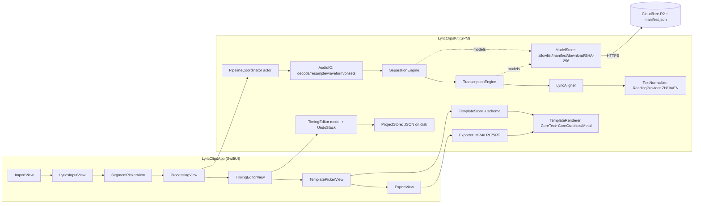
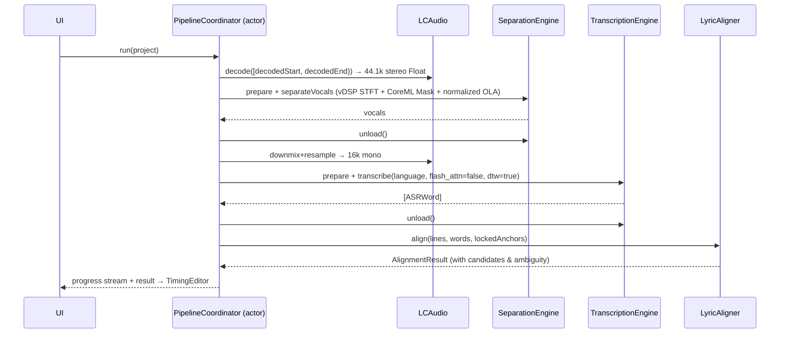

# SCG LyricClips — iOS MVP 开发框架与规格书（v0.2）
> 工作名 `SCG LyricClips`（正式名待定）｜所有者：株式会社SCG Creation / SCG Audio｜起草：2026-11-17（JST）｜版本：v0.2（整合 Codex 审阅与 Gemini 轻量化裁剪）
> 竞品参考：Plastic 的 Clips。本文是唯一权威规格；与本文冲突的实现一律以本文为准，规格有歧义时在实现前或 PR 描述里提出，不要自行发挥。
> 标记约定：✅ 已查证（附链接）｜⚠️ 未查证 / 需在 Phase 0 实测｜⛔ 阻塞上架，未解决前不得发布。

## 0. 一页摘要
- 免费 iOS App：导入歌曲 → 粘贴歌词 → 在设备上分离人声并对齐歌词 → 手动修正时间 → 选 15–60 s 片段 → 套模板 → 导出 1080×1920 MP4 + LRC/SRT。
- 目的是为 SCG Audio 引流和建立品牌：模板带克制的 “Made with SCG Audio” 署名，邮箱订阅可选、不强制。
- 全部本地处理，不上传歌曲，不用云端推理。推理严格限于用户选中的片段（前后各加 1 s padding）；选段前的整曲波形允许通过流式扫描生成低分辨率峰值数据。
- 技术栈：SwiftUI（iOS 17+），Core ML，whisper.cpp（Core ML encoder），AVFoundation（AVAssetWriter），不用 FFmpeg，不用 x264。
- **重要发现 ⛔：Demucs/HTDemucs 的预训练权重不是 MIT，作者明确说只限研究用途且无法授予商业许可**（见 §9）。因此生产环境、主工程 Target 与远程 manifest 严禁包含 HTDemucs；Phase 0 先以“不分离直接识别（Passthrough）”建立基线，并与“Spleeter 2stems（外置 vDSP STFT/iSTFT + Core ML Mask 网络）”对比。
- 先做 1 周技术 spike（Phase 0，采用“Mac 快速筛选 → iPhone 12 真机定标”两步漏斗法），再做 iOS MVP（约 6–8 周）。纯 Swift 核心模块可与 Phase 0 并行开发。Android 以后再做。

## 1. 目标 / 非目标
**目标（MVP）**
- G1 导入：Files（`fileImporter`）和音乐库里本地、无 DRM 的曲目（`MPMediaItem.assetURL != nil`）。支持 mp3/m4a/aac/wav/aiff/flac（以 AVFoundation 能解码为准）。
- G2 粘贴歌词（ZH 简/繁、JA、EN，允许混排）：`rawLyrics` 完整保留用户原文（含空行）；按行拆分为规范化显示行时，空行作为段落分隔元数据（`paragraphIndex` / `isParagraphBreakAfter`）保留，不在编辑器与渲染器中生成空歌词行。
- G3 在波形上选 15–60 s 片段；只对片段 ±1 s 做分离和识别。
- G4 自动对齐到**行级**时间（每行 start/end），给出逐行启发式置信度与重复副歌候选。
- G5 时间编辑器（MVP 核心）：逐行拖动、微调、tap-to-sync、撤销/重做。
- G6 3–5 个模板，预览和导出用同一个渲染器（编码前 BGRA 帧逐像素一致）。
- G7 导出 MP4（H.264 默认，HEVC 可选，使用原混音音轨）+ LRC + SRT，用系统分享面板保存或分享。
- G8 UI 本地化：ja、zh-Hans、zh-Hant、en。
**非目标（MVP 不做）**
- 云端处理、账号体系、上传歌曲、社交 feed、内购或广告。
- 字级卡拉 OK 动画、振假名、竖排、双语字幕、可视化、批量、背景视频、DAW 联动、ASS 导出（都放到 Phase 7+）。
- 流媒体（Apple Music/Spotify）音源，DRM 内容一律不支持。
- iPad 专用布局（可以运行，但不做专门优化）。

## 2. 平台与最低机型
- 最低系统 **iOS 17.0**（产品假设）。iOS 17 的 Core ML 支持 `MLModel.compileModel(at:)` 异步编译和 ML Program。模型分发采用 Cloudflare R2 + 内置受审清单，不依赖高版本系统的 Background Assets 或已弃用的 ODR（见 §8）。
- 最低目标机型 **A14 / iPhone 12 系列（4 GB RAM）**，理由如下：
  - 分离模型加 whisper small 一级模型在 4 GB RAM 下是安全下限。
  - A12/A13（XS/11）同样有 4 GB，但 CPU 和 ANE 都更慢，预计 30 s 片段耗时过长 ⚠️。
  - **设备能力判定与降级策略**：用 `utsname.machine` 识别已知旧机型（A13 及更早），对未知新款机型一律走能力探测（`os_proc_available_memory()` 与 Core ML 预热耗时），**不得用白名单把未来新机型误判为低端设备**。低于 A14 的已知旧机或启动时可用内存 < 1.2 GB 时，默认进入“手动 tap-to-sync”模式（是否在旧机开放 `Passthrough + whisper-base` 由 Phase 0 实测决定）。
- ⚠️ `com.apple.developer.kernel.increased-memory-limit` entitlement 可以放宽 jetsam 上限（[zenn 介绍](https://zenn.dev/mtfum/articles/ios_memory_entitlements?locale=en)）。MVP 先申请，但设计上必须按“不依赖它”来做内存预算。真实峰值内存以 Instruments Activity Monitor / VM Tracker 的 `Physical Footprint` 为准，`os_proc_available_memory()` 仅作运行时余量信号。

## 3. 总体架构

- **分层与跨平台依赖图隔离原则**：
  - 纯 Swift 层（`LCCore`、`LCText`、`LCAlign`、`LCTiming`、`LCTemplates`、`LCSubtitles`、`LCModelStore`）只依赖 `Foundation`（Linux 上允许 `FoundationNetworking`）和 `swift-crypto`，必须在 Linux 上直接通过 `swift test`。
  - **SPM Manifest 隔离（R11）**：`#if canImport(...)` 只能隔离源码编译，不能阻止 SwiftPM 在 Linux 上解析或下载 iOS `binaryTarget`。因此 `Package.swift` 必须使用 `#if !os(Linux)` 条件化包含 Apple 专属 targets（`LCAppleText`、`LCAudio`、`LCSeparation`、`LCTranscription`、`LCRender`、`LCExport`、`LCPipeline`、`LCUI`）以及 `whisper.cpp` xcframework、`Mecab-Swift` 等平台依赖，确保 Linux 下 `swift test` 不下载任何 Apple 专属二进制包。
- 所有引擎都通过 protocol 注入（见 §5），以便替换实现（Spleeter、Passthrough、将来的自训模型或 Android 版）。

## 4. 仓库与 SPM 布局
```
scg-lyricclips/
  AGENTS.md                     # 工作规则
  DEV_SPEC.md                   # 本文件
  App/LyricClips.xcodeproj      # 只有 App target，代码尽量放进 Kit
  App/LyricClips/               # @main, AppDelegate, Assets, Localizable.xcstrings, PrivacyInfo.xcprivacy
  Packages/LyricClipsKit/Package.swift
    Sources/
      LCCore/          # 纯 Swift：数据模型、Project schema、错误类型、时间工具     (Linux OK)
      LCText/          # 纯 Swift：归一化、UTF-16 映射、ReadingProvider 协议、编辑距离 (Linux OK)
      LCAlign/         # 纯 Swift：NWLyricAligner、置信度、候选歧义、有界插值       (Linux OK)
      LCTiming/        # 纯 Swift：TimingEditor 模型、UndoStack、tap-sync 逻辑     (Linux OK)
      LCTemplates/     # 纯 Swift：Template JSON schema、校验、抽象布局计算         (Linux OK)
      LCSubtitles/     # 纯 Swift：LRC/SRT 裁剪、平移与编解码                      (Linux OK)
      LCModelStore/    # 纯 Swift：内置 Allowlist、manifest 解析、SHA-256 校验     (Linux OK)
      LCAppleText/     # Apple：JA MeCab/IPADic、ZH CFStringTransform、CFStringTokenizer
      LCAudio/         # Apple：AVAudioFile 解码、重采样、流式波形、vDSP STFT/iSTFT、onset
      LCSeparation/    # Apple：SeparationEngine 实现（CoreML Spleeter / Passthrough）
      LCTranscription/ # Apple：whisper.cpp 封装（binaryTarget xcframework，WHISPER_COREML=1）
      LCRender/        # Apple：TemplateRenderer（CoreText 排版测量 + CoreGraphics 绘制）
      LCExport/        # Apple：AVAssetWriter MP4 导出
      LCPipeline/      # Apple：PipelineCoordinator actor、进度、取消、文件缓存、内存/热守护
      LCUI/            # SwiftUI 功能视图（可在 App 内 Preview）
    Tests/  (每个 target 一个 XCTest / Swift Testing target；Fixtures/ 放测试数据)
  tools/
    convert/           # Python：coremltools 转换脚本（Spleeter Mask 网络→CoreML、whisper encoder 生成）
    manifest/          # Python：生成 models manifest.json + SHA-256
    bench/             # 设备与 Mac benchmark 场景说明与结果 CSV
  docs/THIRD_PARTY_NOTICES.md, docs/MODEL_PROVENANCE.md, docs/bench-results/
```
- 依赖：whisper.cpp（MIT，锁定 commit 与 xcframework SHA-256，支持 Core ML ✅ [PR #2912](https://github.com/ggerganov/whisper.cpp/pull/2912)）、Mecab-Swift（MIT ✅ [LICENSE](https://github.com/shinjukunian/Mecab-Swift/blob/master/LICENSE)）+ IPADic（保留原词典许可声明）、swift-crypto（Apache-2.0，Linux 上用；Apple 上可用 CryptoKit）。**禁止**引入 FFmpeg、x264、任何 GPL/AGPL 依赖和任何 analytics SDK。
- Bundle ID 占位 `jp.scgcreation.lyricclips`，Team 由 Umi 在 Mac 构建时提供。

## 5. 模块与协议（可替换引擎与文本/语言契约）
```swift
// LCCore
public struct TimeRange: Codable, Hashable, Sendable {
  public var start: Double // 秒，相对原曲 0 点；必须 isFinite && >= 0
  public var end: Double   // 半开区间 [start, end)，必须 isFinite && end > start
}
public struct PipelineProgress: Sendable {
  public var stage: Stage
  public var fraction: Double
  public enum Stage: String, Sendable { case decode, separate, transcribe, align, render, export }
}
public struct AudioBuffer: Sendable { public var sampleRate: Double; public var channels: [[Float]] } // 非交错 PCM

// LCSeparation
public protocol SeparationEngine: Sendable {
  var id: String { get }                    // "spleeter-2stems-coreml-v1" / "passthrough"
  var requiredModels: [ModelID] { get }
  func prepare(store: ModelStore) async throws
  func separateVocals(_ input: AudioBuffer, progress: @Sendable (Double) -> Void) async throws -> AudioBuffer
  func unload() async
}

// LCTranscription
public enum ASRLanguage: String, Codable, Sendable { case zh, ja, en } // 传给 Whisper 的实际语言代码
public struct ASRWord: Codable, Hashable, Sendable {
  public var text: String
  public var start: Double                  // 原曲绝对秒（已加上 decodedStart offset）
  public var end: Double                    // 原曲绝对秒（经词尾推导规则生成，满足 end > start）
  public var prob: Float
  public var isEndEstimated: Bool           // 标记 end 是否由 DTW 单点时刻向后推导得出
}
public struct TranscriptionOptions: Hashable, Sendable {
  public var language: ASRLanguage          // zhHans/zhHant 映射为 .zh；mixed 必须由用户指定或探测出主语言后传入
  public var stylePrompt: String?           // 极短风格引导词（不传长歌词以防幻觉和缓存耦合）
  public var useDTWTimestamps: Bool
  public var flashAttention: Bool           // DTW 启用时必须为 false（见 §7 步骤 3）
}
public protocol TranscriptionEngine: Sendable {
  var id: String { get }
  var runtimeVersion: String { get }        // 锁定的 whisper.cpp commit 或版本号，纳入缓存 key
  var requiredModels: [ModelID] { get }
  func prepare(store: ModelStore) async throws
  /// vocals16kMono: 16kHz 单声道 PCM
  /// decodedStart: 实际解码第一个采样点对应的原曲秒数，即 max(0, segment.range.start - segment.padding)
  func transcribe(_ vocals16kMono: [Float], decodedStart: Double, options: TranscriptionOptions, progress: @Sendable (Double) -> Void) async throws -> [ASRWord]
  func unload() async
}

// LCText
/// 所有文本范围（sourceRange / WordTiming.range）统一定义为原行 String.utf16 的半开区间 Range<Int>（UTF-16 code unit 偏移）
public struct ReadingUnit: Hashable, Sendable {
  public var key: String                    // EN 小写字母串、JA 平假名一拍、ZH 无调拼音音节
  public var sourceRange: Range<Int>        // 映射回当前 LyricLine.text 的 UTF-16 半开区间
}
public protocol ReadingProvider: Sendable {
  func units(for text: String, language: LyricLanguage, primaryLanguage: ASRLanguage) -> [ReadingUnit]
}

// LCAlign
public struct AlignmentCandidate: Codable, Hashable, Sendable {
  public var id: UUID
  public var lineRange: Range<Int>          // 匹配到的歌词行索引范围
  public var normalizedCost: Double         // 按歌词单元数归一化后的对齐代价（>= 0）
  public var lines: [LyricLine]             // 该候选下的定时结果（仅 lineRange 内插值，范围外保持 nil）
}
public enum AmbiguityStatus: String, Codable, Sendable {
  case none                                 // 唯一明显最优解
  case repeatedChorusTie                    // 存在多个近似最优候选（如重复副歌），需用户选择或确认
  case insufficientEvidence                 // ASR 有效词过少或代价过高，建议直接走 tap-to-sync
}
public struct AlignmentResult: Sendable {
  public var lines: [LyricLine]             // 默认选中最优候选（candidates.first）后的完整行列表
  public var candidates: [AlignmentCandidate]
  public var ambiguity: AmbiguityStatus
  public var overallConfidence: Double      // 0...1 启发式分数（UI 不得表述为“校准概率”）
  public var suggestedLineRange: Range<Int>
}
public protocol LyricAligner: Sendable {
  func align(lines: [LyricLine], words: [ASRWord], segment: Segment, language: LyricLanguage, primaryLanguage: ASRLanguage) throws -> AlignmentResult
}

// LCTiming
public protocol TimingEditor {
  var lines: [LyricLine] { get }
  mutating func apply(_ edit: TimingEdit) throws
  mutating func undo()
  mutating func redo()
  var canUndo: Bool { get }
  var canRedo: Bool { get }
}
public enum TimingEdit: Equatable, Sendable {
  case setStart(lineID: UUID, Double)
  case setEnd(lineID: UUID, Double)
  case nudge(lineID: UUID, delta: Double)
  case shiftAll(delta: Double)
  case tapSync(lineID: UUID, at: Double)
  case split(lineID: UUID, utf16Offset: Int) // 必须落在合法 Character 边界上，否则抛 LCError
  case merge(UUID, UUID)
  case editText(UUID, String)                // 修改显示文本，同时清除该行过期的 words 映射并重算状态
  case selectCandidate(UUID)                 // 切换重复副歌候选
}

// LCRender & LCExport & LCModelStore
public protocol TemplateRenderer {
  func prepare(template: Template, project: Project) throws
  func renderFrame(at time: Double, into pixelBuffer: CVPixelBuffer) throws // Apple 专属，输出编码前 32BGRA
}
public protocol Exporter {
  func export(project: Project, template: Template, settings: ExportSettings, progress: @Sendable (Double) -> Void) async throws -> ExportArtifacts
}
public protocol ModelStore: Sendable {
  func status(_ id: ModelID) async -> ModelStatus      // .notDownloaded / .downloading(Double) / .ready(URL) / .corrupt
  func ensure(_ ids: [ModelID], allowCellular: Bool, progress: @Sendable (Double) -> Void) async throws -> [ModelID: URL]
  func purge(_ id: ModelID) async throws                // 若 PipelineCoordinator 正在运行则拒绝删除
  var totalBytesOnDisk: Int64 { get async }
}
```
- 实现清单（MVP）：`SpleeterCoreMLSeparationEngine`（候选）、`PassthroughSeparationEngine`（不分离，只做 mono 下混和 16 kHz 重采样）、`WhisperCppTranscriptionEngine`、`NWLyricAligner`（semi-global Needleman-Wunsch）、`CoreGraphicsTemplateRenderer`、`AVAssetWriterExporter`、`R2ModelStore`。
- 依赖注入与安全门禁：`EngineRegistry` 从远程 manifest 的 `defaults` 读取默认引擎与模型 ID，但**必须通过内置在 App 代码中的受审白名单（`ApprovedModelAllowlist`）校验**（见 §8、§9）。

## 6. 数据模型
```swift
public enum LyricLanguage: String, Codable, Sendable { case zhHans = "zh-Hans", zhHant = "zh-Hant", ja, en, mixed }
public struct Project: Codable, Identifiable, Sendable {
  public static let schemaVersion = 1
  public var schemaVersion: Int
  public var id: UUID
  public var createdAt: Date
  public var updatedAt: Date
  public var title: String
  public var artist: String?
  public var audio: AudioSource               // 沙盒内拷贝的相对路径 + 内容 SHA-256 + 时长 + 采样率 + 原文件名
  public var language: LyricLanguage
  public var primaryASRLanguage: ASRLanguage  // 当 language == .mixed 时由用户选择（默认根据字符占比推断）
  public var rawLyrics: String                // 用户原文，永不修改（含原始空行）
  public var lines: [LyricLine]
  public var segment: Segment
  public var templateID: String
  public var templateOverrides: TemplateOverrides?
  public var exportSettings: ExportSettings
  public var processing: ProcessingInfo?      // 引擎 id、模型版本、耗时、整体置信度、实际后端
}
public struct AudioSource: Codable, Hashable, Sendable {
  public var relativePath: String
  public var contentSHA256: String
  public var duration: Double
  public var sampleRate: Double
  public var originalFilename: String
  public var hasEmbeddedArtwork: Bool
}
public struct Segment: Codable, Hashable, Sendable {
  public var range: TimeRange                 // 时长必须在 15...60 s 内，init、解码与编辑时均校验
  public var padding: Double = 1.0            // >= 0 && <= 5.0
  public var decodedStart: Double { max(0.0, range.start - padding) }
  public func decodedEnd(audioDuration: Double) -> Double { min(audioDuration, range.end + padding) }
}
public struct LyricLine: Codable, Identifiable, Hashable, Sendable {
  public var id: UUID
  public var index: Int
  public var paragraphIndex: Int              // 段落号（由原文空行分隔得出）
  public var text: String
  public var translation: String?             // Phase 7 双语
  public var start: Double?                   // nil = 未定时；若非 nil 则必须 isFinite && >= 0
  public var end: Double?                     // nil = 未定时；若 start/end 均非 nil 则必须 end > start
  public var confidence: Double               // 0...1 启发式分数；manual/tapSync 锁定后置 1.0
  public var source: TimingSource             // .auto / .interpolated / .manual / .tapSync
  public var words: [WordTiming]              // MVP 可以为空；Phase 7 字级卡拉 OK 使用
  public var isInSegment: Bool
  public var isLocked: Bool { source == .manual || source == .tapSync }
}
public struct WordTiming: Codable, Hashable, Sendable {
  public var text: String
  public var range: Range<Int>                // 对应 LyricLine.text 的 UTF-16 半开区间
  public var start: Double
  public var end: Double
  public var reading: String?
}
public enum TimingSource: String, Codable, Sendable { case auto, interpolated, manual, tapSync }
public struct TemplateOverrides: Codable, Hashable, Sendable {
  public var showCredit: Bool = true          // 用户是否保留 "Made with SCG Audio" 署名（持久化到工程）
  public var customBackgroundRelativePath: String?
}
public struct ExportSettings: Codable, Hashable, Sendable {
  public enum Codec: String, Codable, Sendable { case h264, hevc }
  public var codec: Codec = .h264
  public var fps: Int = 30                    // 30 或 60
  public var includeEndCard: Bool = false     // MVP 默认关闭
  public var lrcRelativeToSegment: Bool = true
}
public struct ProcessingInfo: Codable, Hashable, Sendable {
  public var separationEngineID: String
  public var transcriptionEngineID: String
  public var whisperModelID: String
  public var usedCoreMLEncoder: Bool
  public var usedDTWTimestamps: Bool
  public var durationSeconds: Double
  public var overallConfidence: Double
}
```
- 存储：`Application Support/Projects/<uuid>/project.json` + `audio.<ext>`（导入时拷贝）+ `cache/`（存放按输入摘要命名的 `vocals-<hash>.caf` 与 `asr-<hash>.json`，可随时清除重算）。`project.json` 及所有工程目录统一设置 `isExcludedFromBackup = true`（不占用用户有限的 iCloud 备份空间，在隐私与设置页向用户说明本地工程仅保存在本机）。JSON 编码用 `.iso8601` 日期和 `.sortedKeys`。
- 校验契约：所有时间字段（`TimeRange`、`LyricLine.start/end`、`ASRWord.start/end`）在 `init`、`Codable` 反序列化（`init(from:)`）及编辑操作时均必须验证 `isFinite` 且非负，拒绝 `NaN` 或 `Infinity`。

## 7. 处理流水线

**步骤细节**
1. **解码**：
   - 选段界面（`SegmentPickerView`）需要整曲概览波形时，由 `LCAudio` 流式分块读取生成低分辨率峰值数组（例如每秒 20 个 min/max 采样点）并缓存，不将整首歌解码为常驻内存 Float 数组。
   - 进入处理流水线后，用 `AVAudioFile` 只读取 `[segment.decodedStart, segment.decodedEnd(audioDuration))`（通过 `framePosition` seek），输出 44.1 kHz stereo Float32。
2. **分离与归一化拼接（R07 + 外置 vDSP 架构）**：
   - **Spleeter Core ML 转换边界**：为避免 TensorFlow 复数/STFT 算子在 `coremltools` 转换时失败或回退 CPU，**Core ML 模型只包含 Spectrogram Magnitude → Soft Mask 的纯神经网络推理部分**；前向 STFT（`n_fft=4096, hop=1024, Hann 窗`）、高频裁剪/补零、Soft Mask 乘法以及结合原混合音频相位的 iSTFT，全部在 `LCAudio`/`LCSeparation` 中用 Swift + Apple `Accelerate`（`vDSP`）实现。
   - **块级 Overlap-Add（OLA）归一化**：按模型固定窗口切块，25% overlap（即 hop = 75% 窗口长），加 Hann 窗后必须使用**窗权重和归一化**：
     $$\text{out}[t] = \frac{\sum_k \text{chunk}_k[t - k \cdot H] \cdot w[t - k \cdot H]}{\max(\epsilon, \sum_k w[t - k \cdot H])}, \quad \epsilon = 10^{-6}$$
     首尾边界先做反射或零填充以保证内部权重分母稳定，合并后精确裁剪回输入采样点数，消除 25% overlap 下的周期性幅度调制（10.67 dB 纹波）。块与块之间检查 `Task.checkCancellation()` 并上报进度。
3. **识别（R01、R03、R05）**：
   - 锁定 `whisper.cpp` 源码 commit 与 xcframework SHA-256。
   - **显式关闭 Flash Attention 以启用 DTW**：`whisper.cpp` 默认 `flash_attn = true`，会静默禁用 `dtw_token_timestamps`（见 `whisper.cpp` `whisper_init_with_params_no_state`）。初始化 `whisper_context_params` 时**必须显式设置 `flash_attn = false`、`dtw_token_timestamps = true`**，并配置匹配原模型架构的 `dtw_aheads_preset`（量化模型如 `small-q5_1` 同样使用对应架构的 preset）。
   - **语言与 Prompt 策略（两阶段锚定法）**：显式传入 `ASRLanguage`（`zh`/`ja`/`en`），禁止自动检测。**默认不将用户歌词塞入 `initialPrompt`**（一是因为首次识别尚不知片段对应哪几行歌词，二是因为长歌词 prompt 在伴奏期极易引发 Whisper 幻觉背诵，三是会导致改歌词必须重跑 ASR）。如需引导，只允许传固定短语风格的 `stylePrompt`；真正的歌词文本留给下游 `NWLyricAligner` 做读音级模糊对齐。
   - **Token 拼词与时间戳转换**：
     - 过滤 special tokens（`[_BEG_]`、`[_TT_*]` 等）。
     - 中文、日文及 Emoji 的单个字符可能被 BPE 拆成多个 byte tokens，适配器必须先按 UTF-8 字节流拼回合法 Unicode 文本单元，再聚合 `t_dtw`。
     - `t_dtw` 单位为 10 ms（centiseconds），转换为原曲绝对秒的唯一公式为：`absTime = segment.decodedStart + Double(t_dtw) * 0.01`（只加一次 `decodedStart`）。
     - 因为 `t_dtw` 是单点时刻而非区间，词的 `start` 取首 token 的时刻，词的 `end` 取 `min(nextWordStart, start + maxWordDuration)`（或结合 token 音频能量帧尾估算），确保 `end > start` 且末尾词不会无限延长到片段结束；若 `t_dtw < 0`（无效值），回退到 segment 级线性插值。
   - ⚠️ 首次在设备上加载 Core ML encoder 时 ANE 编译较慢，要显示“首次准备中”，并在模型下载完成后后台预热一次；在 `ProcessingInfo` 中记录 Core ML encoder 是否真实加载成功。
4. **对齐（`NWLyricAligner`，纯 Swift，Linux 可测，R05、R06）**：
   - a) **归一化与 UTF-16 映射**：全角转半角，去掉标点，统一大小写。**括号内容默认保留**（因为很多歌曲括号内是实际唱出的副歌或和声），仅剔除明确匹配舞台说明正则的标注（如 `(x2)`、`（リピート）`、`[Chorus]`）。归一化过程保留每个字符回溯到原行 `String.utf16` 的偏移映射。
   - b) **转成读音单元 `ReadingUnit`**：EN 用字母串，以词为单位；JA 先经 MeCab 拿到读音，片假名转平假名，长音和小字归一，按拍（mora）切分；ZH 用 `CFStringTransform(kCFStringTransformMandarinLatin)` 再去声调，按音节切分；`mixed` 混排语言下，拉丁字母走 EN、假名走 JA，而汉字（Han script）按用户指定的 `primaryASRLanguage`（中文或日文）加前后文假名特征决定走 MeCab 还是拼音。
   - c) ASR 词同样转成单元，词的时间按单元数在内部平均分配。
   - d) **带锁定锚点约束的 semi-global 对齐**：
     - 若部分歌词行已被用户手动锁定（`line.isLocked == true`，含 `.manual` 和 `.tapSync`），这些行作为硬边界锚点，只对锚点之间的未锁定行区间分段执行对齐，绝不覆盖锁定行，且自动行的起止时间不得穿过锁定锚点。
     - 未锁定时，歌词一侧两端空位免费（因为用户粘贴的是整首歌，而片段只覆盖其中几行）。代价：匹配 0；相似替换（拼音声母或韵母相同、假名同行/同段、编辑距离 ≤1）0.5；完全替换 1.0；空位 1.0。代价按匹配区间的歌词单元数 $N$ 归一化：`normalizedCost = rawCost / Double(max(1, N))`。
   - e) **重复副歌与平局歧义检测（R06）**：
     - 在 DP 回溯矩阵最后一行寻找局部极小值峰值（非重叠行区间）。
     - 若次优候选与最优候选满足：`candidate.normalizedCost - best.normalizedCost <= max(0.02, 0.05 * best.normalizedCost)`（当 `best.normalizedCost == 0` 完美匹配平局时，`0 <= 0.02` 恒成立，100% 触发歧义），则将 `ambiguity` 设为 `.repeatedChorusTie`，把前 $K$ 个候选全部放入 `AlignmentResult.candidates`，由 UI 弹窗让用户选择“这是第几次副歌”。
     - 若没有任何候选的匹配单元比例达到最低门限（如有效匹配单元 < 20% 或 `normalizedCost > 0.75`），将 `ambiguity` 设为 `.insufficientEvidence`。
   - f) **有界行时间推导与插值**：
     - **只对选中候选的 `suggestedLineRange` 内部行赋时间**；落在该范围之外的整首歌其余歌词保持 `start = nil, end = nil, isInSegment = false`，绝不把未唱到的歌词塞进片段内。
     - 候选范围内有匹配单元的行：`start` 取首个匹配单元 `start`，`end` 取末个匹配单元 `end`。
     - 候选范围内完全漏识别的内部行：仅在前后相邻已定时锚点之间按字数做有界线性插值，并标 `.interpolated`。保证单调：`start(i) >= end(i-1) - 0.05`。
   - g) **启发式置信度**：行置信度 = 匹配单元比例 × 平均相似度；整体置信度 = 候选范围内按字数加权的平均值。
5. **进入编辑器**：置信度 < 0.5 的行标黄；整体置信度 < 0.6 或 `ambiguity == .insufficientEvidence` 时弹出横幅推荐“使用 tap-to-sync”。

**单任务互斥、确定性文件缓存与取消（R03、R04 轻量化方案）**
- **单任务互斥**：`PipelineCoordinator` 是 actor，内部维护当前任务句柄 `activeTask` 与递增 `runID`。由于 actor 在 `await` 处可重入，新调用 `run()` 时若检测到已有任务在跑，必须先 `cancel()` 旧任务并 `await activeTask?.value` 等待底层引擎安全退出、释放模型后，再启动新任务；旧任务退出后比对 `runID`，禁止覆写新状态。
- **两层取消语义**：用户点击取消后，UI 在 **500 ms 内**立即响应并切回上一页（逻辑取消）；底层 Core ML 预测块或 whisper `abort_callback` 完成后才执行 `unload()` 释放模型内存，严禁在 C++/Core ML 推理尚未返回时并发销毁上下文。
- **确定性文件缓存（替代复杂 Checkpoint 状态机）**：
  - 不在 `project.json` 中维护复杂的多阶段事务型 Checkpoint 状态机。因为片段仅 15–60 s，崩溃、杀进程或只改歌词重跑时，直接通过确定性文件缓存跳过已完成阶段：
    - `separationCacheKey = SHA256(audio.contentSHA256, segment.decodedStart, segment.decodedEnd, separationEngine.id, modelSHA256, windowParamsVersion)` → 对应 `cache/vocals-<key>.caf`（先写 `.tmp` 再原子 rename）。
    - `asrCacheKey = SHA256(separationCacheKey, transcriptionEngine.id, transcriptionEngine.runtimeVersion, whisperModelSHA256, encoderSHA256, options.language, options.stylePrompt, options.useDTWTimestamps)` → 对应 `cache/asr-<key>.json`。
  - 当用户只修改歌词或手动调整某行时间后重跑对齐时，`separationCacheKey` 和 `asrCacheKey` 100% 命中本地缓存，毫秒级直接执行 `NWLyricAligner`。
  - Benchmark 模式（`tools/bench`）提供显式开关禁用结果文件缓存，但保留 Core ML 模型预热状态。
- **内存与热状态**：同一时刻只常驻一个大模型（分离结束先 `unload()` 再加载 whisper）。监听 `ProcessInfo.thermalStateDidChangeNotification`，`.serious` 降线程，`.critical` 暂停并提示。切后台时用 `beginBackgroundTask` 收尾，超时则触发取消（已落盘的 `vocals`/`asr` 缓存文件下次可直接使用）。

## 8. 模型分发（ModelStore）
**方案对比与决定**
| 方案 | 优点 | 缺点 | 结论 |
|---|---|---|---|
| Cloudflare R2 + 远程 manifest + 内置 Allowlist | iOS 17 可用；能切版本、回滚；R2 出口流量免费；内置白名单防篡改 | 需实现断点续传与解压校验 | **MVP 采用** |
| Hugging Face 直链 | 零成本 | 受第三方可用性和限速影响，不好控版本 | 只作开发期镜像备用 |
| On-Demand Resources / Background Assets | 系统托管 | ODR 旧机制受限，Background Assets 需高版本系统 | MVP 不用 |

- **内置受审白名单门禁（R09 轻量化方案）**：
  - App 代码内硬编码 `ApprovedModelAllowlist`（包含允许在生产环境运行的 `engineID`、`modelID`、预期文件 `sha256` 及许可证状态）。
  - 远程 `manifest.v1.json` 只能用于获取下载 URL 或在白名单已收录的受审版本之间切换默认配置（`defaults`）。如果远程 manifest 指向了不在内置白名单中的未知模型、未受审模型或 hash 不匹配的 companion，生产端直接拒绝加载并回退到内置安全配置或手动模式。这样无需在 MVP 阶段搭建复杂的 Ed25519 密钥签发基础设施，即可保证绝对合规与防篡改。
- **统一 Core ML 资源格式与磁盘空间预算（R10）**：
  - 所有 Core ML 伴随模型（如 whisper encoder、Spleeter mask 网络）**统一采用 `.mlpackage.zip` 格式分发**，下载并校验 SHA-256 后解压，在设备端调用 `MLModel.compileModel(at:)` 编译为 `.mlmodelc` 并按 `<modelID>/<version>/<osBuild>/` 缓存（避免跨 iOS 系统升级后 `.mlmodelc` 失效）。
  - 解压 `.zip` 时必须校验每個条目的相对路径（禁止包含 `..` 或绝对路径，防 Zip Slip）并限制总展开字节数不超过声明的 `unpackedBytes * 1.1`。
  - manifest 中每个资源及 companion **必须填写真实的 `downloadBytes` 和 `unpackedBytes`（禁止填 0）**。下载前及编译前检查 `volumeAvailableCapacityForImportantUsage` 是否 ≥ `(downloadBytes + unpackedBytes * 2)`。
  - 当 `PipelineCoordinator.isRunning == true` 时，禁止执行 `ModelStore.purge(_:)`。
- manifest 示例（`https://models.scgaudio.example/lyricclips/manifest.v1.json`）：
```json
{
  "schema": 1,
  "updatedAt": "2026-11-17T00:00:00Z",
  "minAppVersion": "1.0.0",
  "defaults": {
    "separation": "spleeter-2stems-coreml-v1",
    "transcription": "whisper-small-q5_1"
  },
  "models": [
    {
      "id": "whisper-small-q5_1",
      "version": "1",
      "format": "ggml-bin",
      "url": "https://.../ggml-small-q5_1.bin",
      "downloadBytes": 190000000,
      "unpackedBytes": 190000000,
      "sha256": "<64-char-hex>",
      "expectedRelativePath": "ggml-small-q5_1.bin",
      "companions": [
        {
          "id": "whisper-small-encoder-coreml",
          "format": "mlpackage-zip",
          "url": "https://.../ggml-small-encoder.mlpackage.zip",
          "downloadBytes": 165000000,
          "unpackedBytes": 340000000,
          "sha256": "<64-char-hex>",
          "expectedRootDirectory": "ggml-small-encoder.mlpackage"
        }
      ],
      "license": "MIT",
      "sourceURL": "https://github.com/openai/whisper",
      "provenance": "verified"
    }
  ]
}
```

## 9. 许可证与模型来源（⛔ 上架前必须全部是 ✅）
| 组件 | 用途 | 代码许可 | 权重/数据许可 | 状态 |
|---|---|---|---|---|
| whisper.cpp | ASR 运行时 | MIT ✅ | — | ✅ |
| OpenAI Whisper 权重（ggml 转换版） | ASR | MIT ✅ | MIT ✅ [openai/whisper LICENSE](https://github.com/openai/whisper#license)（需在 provenance 记录原始权重与转换脚本 hash） | ✅ |
| Whisper Core ML encoder（自转换 `.mlpackage`） | ASR 加速 | MIT 衍生 | 同上 | ✅ |
| Demucs / HTDemucs | 仅限本地科研基线参考 | MIT ✅ | **权重非 MIT，仅限研究用途且作者无法授权** ✅ [issue #327](https://github.com/facebookresearch/demucs/issues/327)、[adefossez README](https://github.com/adefossez/demucs#license) | ⛔ **主仓库、生产代码与远程 manifest 严禁包含**（仅限 Phase 0 本地独立脚本跑分对比） |
| Spleeter 2stems | 人声分离（候选） | MIT ✅ | JOSS 论文写明“source code and pre-trained models … MIT” ✅ [paper.md L85](https://github.com/deezer/spleeter/blob/master/paper.md#L85)，但 README 只写代码是 MIT（[#898](https://github.com/deezer/spleeter/issues/898)、[#957](https://github.com/deezer/spleeter/issues/957)） | ⚠️ 保留官方权重与 JOSS 论文证据链；建议 Umi 视商业需要向 Deezer 发信确认 |
| Open-Unmix / Meta MMS / UVR / MDX / RoFormer | — | — | MUSDB18-HQ / CC-BY-NC / 来源不明 | ❌ 不用 |
| Mecab-Swift + MeCab + IPADic | JA 分词与读音 | 封装为 MIT ✅ [LICENSE](https://github.com/shinjukunian/Mecab-Swift/blob/master/LICENSE)；MeCab 选 BSD | IPADic 宽松许可（需在 Notices 完整保留 MeCab BSD 与 ICOT/NAIST 版权声明） | ✅（需在 T6-2 核对声明文本） |
| Apple CFStringTransform / CFStringTokenizer | ZH 拼音、JA 兜底 | 系统 API | — | ✅ |
| 字体 | 模板渲染 | 系统字体（Hiragino Sans、PingFang SC/TC、SF）或内置 OFL 字体 | ⚠️ T6-2 前确认系统字体渲染进导出视频的条款，或直接内置 OFL 的 Noto Sans CJK 子集 | ⚠️ |
- 交付物：`docs/THIRD_PARTY_NOTICES.md`、`docs/MODEL_PROVENANCE.md`（每个模型写明来源 URL、commit、源文件与转换产物 SHA-256、转换工具版本、许可、核实人和日期），App 内“设置 → 第三方许可”页面显示同样内容。
- **分离路线决策树（Phase 0 输出）**：
  1. 先验证 **不分离直接识别（`Passthrough` + Whisper DTW）**：若在测试集上达到绝对验收下限（起点误差中位数 ≤ 200 ms，≥ 80% 的行在 ±300 ms 内），且与分离路线差距 < 5 个百分点 → **MVP 默认不分离**（省去 70 MB+ 下载、约 45% 耗时及 Spleeter 授权不确定性）。
  2. 若 `Passthrough` 不达标，而 `Spleeter 2stems Core ML` 明显达标 → 采用 Spleeter（同步推进 Deezer 确认）。
  3. 若两者都不达标 → 评估商业 SDK 授权或缩小 MVP 自动对齐承诺（以 Tap-to-sync 为主流程）。

## 10. 时间编辑器（MVP 核心）
- 布局：上方是片段波形加播放头；下方是歌词行列表，每行显示 `start`、`end` 和启发式匹配标记（低分标黄，手动锁定标已确认图标）。
- 操作：
  - 点一行，从 `max(segment.range.start, line.start - 0.5)` 开始播放。
  - 在波形上拖动行块的左右边缘调整时间，吸附到 onset（能量突变点，±80 ms 内），按住时临时关闭吸附。
  - 微调按钮：±10 ms、±50 ms、±100 ms，长按连续调整。
  - 全局偏移滑块：±2 s。
  - 拆分和合并行，修改行文字（只改 `LyricLine.text`，`rawLyrics` 不动；拆分点 `utf16Offset` 必须落在合法 `Character` 边界，修改文字后自动清空旧 `words` 映射）。
- **Tap-to-sync 模式与时钟契约（R08）**：
  - 从片段起点播放，可选 0.5×、0.75×、1× 速度（`AVAudioUnitTimePitch`，rate = $r$，不变调）。
  - **统一时钟公式**：不能直接用墙钟时间相减。设点击瞬间从 `AVAudioPlayerNode`（结合 `lastRenderTime` 与 `playerTime(forNodeTime:)`）读出的当前音频采样帧对应的**原曲时间**为 $t_{\text{node}}$（秒），当前音频会话输出延迟为 $L_{\text{out}} = \text{AVAudioSession.sharedInstance().outputLatency}$（墙钟秒），用户反应时间补偿为 $\Delta_{\text{react}}$（墙钟秒，默认 `+0.080` s），则实际写入的原曲时间戳为：
    $$t_{\text{song}} = \text{clamp}\big(t_{\text{node}} - r \cdot (L_{\text{out}} + \Delta_{\text{react}}), \; \text{segment.range.start}, \; \text{segment.range.end}\big)$$
    注意在变速播放（rate $r \neq 1$）下，墙钟延迟 $(L_{\text{out}} + \Delta_{\text{react}})$ 必须乘以播放速率 $r$ 才能折算为原曲时间偏移。
  - 每点一下屏幕，把当前行 `start` 设为 $t_{\text{song}}$，若上一行未显式结束则同时将上一行 `end` 设为 $t_{\text{song}}$；双击表示“当前行在此结束，后面留白（不立即开始下一行）”。
- 撤销/重做：`UndoStack` 至少保留 100 步，每个手势结束算一步。
- 锁定规则：手动改过的行设 `source = .manual`，Tap 过的行设 `source = .tapSync`，两者均满足 `isLocked == true`、`confidence = 1.0`；重新跑对齐时**严禁覆盖任何 `isLocked` 行**，且将其作为硬边界约束相邻 `.auto` / `.interpolated` 行。

## 11. 模板系统
- 模板 = 一个 JSON 文件加可选资源（背景图），放在 App bundle 的 `Templates/<id>/template.json`。
- **渲染与排版职责边界（R13）**：
  - 纯 Swift 层的 `LCTemplates` 负责 JSON Schema 校验、时间轴激活行选择、动画插值进度计算（`fadeUp`/`pop`/`typewriter` 参数）及安全区矩形计算，通过抽象的 `TextLayoutProvider` 协议获取文本行测量结果（Linux 单测注入确定性的 `MockTextLayoutProvider`）。
  - Apple 层的 `CoreGraphicsTemplateRenderer` 使用 CoreText 完成真实的字体回退、CJK 禁则断行与 `autoShrink` 字号缩放，并将结果绘制进 `kCVPixelFormatType_32BGRA` 的 `CVPixelBuffer`。
  - 预览和导出调用同一个 `renderFrame(at:into:)`，保证**编码前 BGRA 像素帧逐像素一致**。
- 安全区：TikTok、Reels 的界面会盖住顶部约 8%、底部约 20%、右侧约 12%，歌词必须布局在 `safeArea` 内。
- MVP 模板（5 个）：`minimal-center`（单行居中淡入淡出）、`two-line-next`（当前行加下一行半透明）、`typewriter`（逐字出现，按行内字符数平均分配时间）、`big-bold-pop`（大号粗体弹出）、`artwork-blur`（读取导入音频内嵌封面 `AVAsset.metadata` 做高斯模糊背景，无内嵌封面时自动回退到模板定义的 `gradient`）。
- JSON Schema（`schema: 1`）：与 v0.1 保持一致（包含 `canvas`、`safeArea`、`background`、`text`、`layout`、`animation`、`credit`）。
- 署名：默认开启（`Project.templateOverrides.showCredit = true`），用户可以关闭并持久化到工程。署名不得遮挡歌词，不能做成闪烁或动画。

## 12. 导出规格与字幕裁剪规则（R08）
| 项 | 值 |
|---|---|
| 容器 | MP4（`.mp4`），`shouldOptimizeForNetworkUse = true`（moov 前置） |
| 视频 | 1080×1920，30 fps（可选 60），H.264 High Profile，约 10 Mbps（30 fps）或 16 Mbps（60 fps），关键帧间隔 2 s；可选 HEVC Main 约 6 Mbps，色彩空间 BT.709 |
| 音频 | **必须使用原混音音频**（严禁导出分离后的 vocals stem）；AAC-LC，48 kHz，立体声，256 kbps；裁剪到 `[segment.range.start, segment.range.end)`，首尾各加 30 ms 线性淡入淡出避免爆音；音频与视频 PTS 均从导出文件的 `0.0 s` 起点对齐开始 |
| 时长 | 等于片段长度（15–60 s）；MVP 默认关闭片尾卡 |
| 实现 | `AVAssetWriter` + `AVAssetWriterInputPixelBufferAdaptor`（像素格式 `kCVPixelFormatType_32BGRA`，用 pixel buffer pool）；使用系统硬件编码器 |
| 性能目标 | 30 s 视频在 iPhone 12 上 ≤ 20 s 导出完（Phase 0/5 真机验证目标） |

**字幕（LRC / SRT）裁剪、平移与格式化契约（R08）**
1. **缺失 `end` 的回退补全**：若某已定时行只有 `start` 而 `end == nil`，先按原曲时间计算回退结束时间：
   $$\text{rawEnd} = \min(\text{nextTimedLineStart} - 0.05, \; \text{line.start} + 5.0, \; \text{segment.range.end})$$
   若补全后 $\text{rawEnd} \le \text{line.start}$，该行视为无效定时，导出前报错或跳过，绝不写出零长度或负长度字幕。
2. **先求交集、再平移、最后量化**：
   - 对每一行 `[line.start, rawEnd)`，先与片段区间 `[segment.range.start, segment.range.end)` 求交集：
     $$s_{\text{clip}} = \max(\text{line.start}, \text{segment.range.start}), \quad e_{\text{clip}} = \min(\text{rawEnd}, \text{segment.range.end})$$
   - 若 $e_{\text{clip}} \le s_{\text{clip}}$（完全落在片段外），直接丢弃该行。
   - 若用户选择“相对片段起点”（默认）：平移为 $s_{\text{rel}} = s_{\text{clip}} - \text{segment.range.start}$，$e_{\text{rel}} = e_{\text{clip}} - \text{segment.range.start}$（保证 $0 \le s_{\text{rel}} < e_{\text{rel}} \le \text{segmentDuration}$）。
   - **量化进位与防零长**：
     - **SRT**：量化到毫秒（`round(t * 1000)`），正确处理 `59.9996 s -> 00:01:00,000` 进位及 `>= 3600 s` 小时位；`clipDurationMs = floor(segmentDuration * 1000)`；若 `startMs >= clipDurationMs` 则丢弃。先将 endMs 限制到 `min(clipDurationMs, nextCueStartMs ?? clipDurationMs)`；若 `endMs == startMs`，仅在 `startMs + 1` 不超过上述上限时扩为 1 ms，否则丢弃不可表达的残片。禁止量化后越界或重叠下一行。输出 UTF-8 LF，序号从 1 连续递增。
     - **LRC**：量化到百分之一秒（`round(t * 100)`，正确处理 `59.996 s -> [01:00.00]` 进位）。为表达句尾空白（当本行 $e_{\text{rel}} < \text{nextLineStart}_{\text{rel}} - 0.10$ 或为最后一行且 $e_{\text{rel}} < \text{segmentDuration}$ 时），在该行结束时刻额外输出一行空文本时间标签 `[mm:ss.xx]` 作为清屏标记。解析器支持标准 `[mm:ss.xx]`、`[mm:ss.xxx]`、同行多时间标签展开及 `[offset:±ms]`，往返测试验证规范化后的时间与文本等价（不要求通过有损 LRC 恢复 `UUID` 或 `confidence`）。

## 13. 隐私、条款、App Store（R14）
- **隐私与离线承诺**：
  - 音频、歌词和生成结果都只保存在本机沙盒，不上传任何服务器。工程目录与模型目录均设置 `isExcludedFromBackup = true`（不进入 iCloud 备份），并在设置页说明“卸载 App 会同时清除本地工程”。
  - 当所需模型已下载（或使用纯手动 Tap-to-sync 模式）时，App 支持**完全离线运行**。
  - 模型下载与 manifest 请求只发送纯静态资源 GET 请求，URL 与 Header 中严禁携带曲名、文件名、歌词或音频 hash。
- **邮箱订阅与隐私标签核查**：MVP 不在 App 内直接收集邮箱输入。首次导出成功后显示可永久关闭的引流卡片，点击用 `SFSafariViewController` 打开 SCG Audio 官网页面。在 T6-2 提交审核前，根据官网实际日志/Cookie 行为与 Apple 最新 App Privacy 披露规则核对隐私标签。
- **Privacy Manifest（`PrivacyInfo.xcprivacy`）**：在 T6-2 扫描主工程及 `whisper.cpp`、`Mecab-Swift` 实际调用的 Required Reason API（如 `UserDefaults`、`FileTimestamp`、`SystemBootTime`、`DiskSpace`），按实际调用项精确声明。
- **App Store 注意**：安装包 < 100 MB；下载模型前明确弹窗显示总下载字节数并在蜂窝网络下征得确认；示例与截图全部使用 SCG Audio 自有版权曲目。

## 14. 测试策略
- **单元测试（Linux 能跑，纯 Swift targets）**：
  - `LCText`：归一化、UTF-16 范围映射（含 Emoji、组合重音、半角片假名、括号歌词保留与舞台说明过滤）、假名转换、拼音去声调、编辑距离。
  - `LCAlign`：fixture 覆盖 8 类以上场景（完全匹配、ASR 错 30%、片段只覆盖中间 4 行、**重复副歌零代价平局触发 `.repeatedChorusTie`**、片段内部漏行有界插值且**片段外歌词绝不插值**、**`.manual`/`.tapSync` 锁定锚点不被覆盖且约束邻行**、繁简混排、空 ASR 返回 `.insufficientEvidence`）。
  - `LCTiming`：每种 `TimingEdit`、非法 UTF-16 拆分边界拦截、修改文本清理过期 `words`、Undo/Redo、单调性约束。
  - `LCSubtitles`：先求交再平移（跨左/右边界裁剪无负时间）、缺失 `end` 补全、LRC 句尾清屏空标签、59.995 s 进位、超 1 小时、规范化往返测试。
  - `LCTemplates`：5 个内置模板 schema 校验、未知字段容忍、注入 `MockTextLayoutProvider` 下的 `LayoutEngine` 确定性输出。
  - `LCModelStore`：内置 `ApprovedModelAllowlist` 拦截未知/篡改模型、`.mlpackage.zip` 路径穿越（Zip Slip）拦截、空间预算计算、SHA-256 校验。
- **Apple 侧测试（Mac Studio + 模拟器/真机）**：
  - **Spleeter / OLA 数值重构测试（R07）**：恒定直流信号、正弦波、脉冲及非整窗口长度音频经过 25% overlap 归一化 OLA 后，全区间幅度误差 < $10^{-5}$、采样点数完全一致；Spleeter Core ML 输出与 Python TF 原版输出对比数值误差。
  - **渲染与导出分开验收（R13）**：
    - 编码前：预览与导出调用同一 `renderFrame` 生成的 `CVPixelBuffer`（BGRA）逐像素完全一致；与固定 OS/字体环境下的 Golden PNG 对比（容差 ≤ 2/255，差异像素 < 0.5%）。
    - 编码后：检查生成的 MP4 分辨率、fps、BT.709、时长误差 < 1 帧、使用原混音音轨、首尾淡入淡出无爆音。
  - **Tap-to-sync 时钟注入测试（R08）**：在 0.5× / 0.75× / 1.0× 速率及模拟 `outputLatency` 下注入点击事件，验证计算出的 $t_{\text{song}}$ 数学误差为 0。
- **Phase 0 两步漏斗 Benchmark 与验收线（R12）**：
  - 测试集：Umi 提供自有版权曲目（ZH、JA、EN 各 3–5 首），人工标注逐行 `start`、`end` 及重复副歌序号（禁止提交未授权公开的商业母带到公开仓库，音频放本地，仓库只存脱敏指标与合成 fixture）。
  - **统计口径**：按全部参考行统计（**漏识别行、选错副歌段落一律计入失败并体现在 P90 与覆盖率中，不得只挑匹配成功的行算误差**）。
  - **两步漏斗法**：
    1. **Step A（Mac Studio 快速筛选）**：用 CLI 跑矩阵，先跑 `Passthrough + whisper-base (flash_attn=false, DTW=true)` 最小基线，再对比 `small-q5_1` 与 `Spleeter`。
    2. **Step B（iPhone 12 真机定标）**：将胜出的 2–3 个配置放到 iPhone 12 与较新机型上，用 Instruments 实测耗时、Physical Footprint 峰值内存、发热状态与取消退出耗时。

## 15. 分阶段任务清单（Tickets）
> 规则：按依赖顺序推进。纯 Swift 模块（T1-2 ~ T1-5、T2-1、T2-3、T3-5、T4-1）不依赖真机，可在云端先行开发并通过 `swift test`；Apple 与真机相关票在 Mac Studio + Xcode 上验证。

### Phase 0 — 技术 Spike（1 周，独立 `spike/` 或 `tools/` 验证）
- **S0-0 工具链与跨平台包骨架验证**：建立 `Package.swift`（实现 Linux 与 Apple 依赖图隔离）及合成检查脚本。AC：Linux 下 `swift test` 不拉取任何 Apple binaryTarget 并全部通过。
- **S0-1 & S0-2 Passthrough + Whisper DTW 最小基线**：锁定 `whisper.cpp` 版本，显式设置 `flash_attn = false, dtw_token_timestamps = true`，实现 UTF-8 token 拼合与 `decodedStart + t_dtw * 0.01` 转换。AC：确认 DTW 真实生效（非静默关闭）、日志确认 Core ML encoder 加载状态、输出合法 `[ASRWord]`。
- **S0-3 Spleeter Mask 网络 Core ML 转换与 vDSP OLA**：`tools/convert/spleeter_to_coreml.py` 导出纯 Mask 网络，配合外置 STFT/iSTFT 与窗权重归一化 OLA。AC：恒定信号/正弦波 OLA 零纹波重构；在 Mac 上对比 Core ML 与 TF 原版输出误差（独立时间盒，若转换受阻则详细记录算子原因，不阻塞 Passthrough 路线）。
- **S0-4 简易对齐器验证**：验证带候选平局检测与有界插值的 `NWLyricAligner`。AC：在测试曲目上输出完整覆盖率、P50/P90 起点与终点误差。
- **S0-5 两步漏斗 Benchmark**：Step A 在 Mac Studio 筛选模型配置（禁用结果缓存），Step B 在 iPhone 12 真机实测耗时与 Footprint 内存。AC：产出 CSV 和 `docs/spike-report.md`。
- **S0-6 JA/ZH 读音与混排验证**：验证 `Mecab-Swift` + IPADic 及 `CFStringTransform` 在含英文混排歌词下的读音准确率与 UTF-16 范围映射。
- **Gate**：Umi 审阅 `spike-report.md` 后，按 §9 决策树拍板分离路线、默认 Whisper 模型和旧机降级策略，再启动 Apple 端业务组装。

### Phase 1 — 基础与纯 Swift 核心（可与 Phase 0 并行）
- **T1-1 仓库与 SPM 骨架**：按 §3、§4 建立条件化 `Package.swift`、空 targets、CI 配置。AC：Linux `swift test` 与 macOS `xcodebuild test` 通过。
- **T1-2 LCCore 数据模型**：§6 全部类型、Codable 有限数校验、`Segment` 边界校验、`ProjectMigrator`。AC：含非法浮点数（NaN/Inf）和越界区间的反序列化拦截单测通过。
- **T1-3 ProjectStore**：`Application Support` 增删改查、原子写入、`isExcludedFromBackup = true`、音频拷贝与 SHA-256 计算。AC：中断写入恢复单测通过。
- **T1-4 LCSubtitles**：§12 字幕先求交再平移、缺失 `end` 回退、LRC 清屏标签、SRT/LRC 进位与编解码。AC：§14 全部边界情况单测通过。
- **T1-5 LCModelStore（纯 Swift 部分）**：`ApprovedModelAllowlist`、manifest 解析、空间预算计算、Zip 路径安全校验逻辑、SHA-256 校验。AC：拒绝未受审模型与 hash 错误单测通过。

### Phase 2 — 处理流水线
- **T2-1 LCText**：归一化、UTF-16 偏移映射、括号舞台说明过滤、`ReadingProvider` 协议、`FixtureReadingProvider`、EN provider。AC：含 Emoji/组合字符/混排的 UTF-16 映射单测通过。
- **T2-2 LCAppleText**：JA MeCab + ZH `CFStringTransform` 实现及混排汉字上下文分发。AC：macOS 50 句混排 fixture 测试通过。
- **T2-3 LCAlign**：`NWLyricAligner`，含 `normalizedCost`、重复副歌平局检测（`.repeatedChorusTie`）、候选区间内有界插值、`.manual`/`.tapSync` 锁定锚点约束。AC：§14 的 8 类场景全部通过；1k×1k 对齐 < 50 ms。
- **T2-4 LCAudio**：流式概览波形生成、片段 `[decodedStart, decodedEnd)` 解码、重采样、vDSP STFT/iSTFT、归一化 OLA、onset 检测。AC：恒定信号/正弦波 OLA 重构误差 < $10^{-5}$。
- **T2-5 LCSeparation**：`PassthroughSeparationEngine` 与 `SpleeterCoreMLSeparationEngine`（若 Gate 选用），支持块间取消。AC：拼接无纹波，取消后安全退出。
- **T2-6 LCTranscription**：`whisper.cpp` 封装（强制 `flash_attn = false` 当启用 DTW），UTF-8 byte tokens 拼词，绝对时间转换，`abort_callback`。AC：合成语音词序列单调、无破碎汉字。
- **T2-7 LCPipeline**：`PipelineCoordinator` actor（单任务互斥与 `runID` 防重入）、确定性文件缓存（`vocals-<key>.caf` / `asr-<key>.json`）、内存与热状态守护、降级路由。AC：并发调用互斥、改歌词命中 ASR 缓存、改语言使 ASR 缓存失效单测全部通过。
- **T2-8 R2ModelStore（Apple 部分）**：后台下载、`.mlpackage.zip` 安全解压、`MLModel.compileModel(at:)` 编译与缓存、运行期防 `purge` 保护。AC：真机断网续传与编译预热由 Umi 验收。

### Phase 3 — UI 与时间编辑器
- **T3-1 导入流程**：Files 和音乐库导入，拦截 DRM，首启条款同意页。
- **T3-2 歌词输入**：保留 `rawLyrics` 空行作为段落元数据，混排时选择主语言，行预览。
- **T3-3 片段选择器**：流式概览波形、15–60 s 选区限制、预听。
- **T3-4 处理页**：进度条、阶段文字、500 ms UI 取消响应、重复副歌候选选择弹窗、模型下载大小确认。
- **T3-5 TimingEditor 模型（LCTiming）**：§10 全部 `TimingEdit`、UTF-16 字符边界校验、修改文本清理 `words`、100 步 `UndoStack`。AC：Linux 单测通过。
- **T3-6 TimingEditor UI**：行列表、波形块拖动、onset 吸附、微调按钮、全局偏移、点击跳播。AC：iPhone 12 上 60 fps 流畅。
- **T3-7 Tap-to-sync**：变速播放（0.5×/0.75×/1×）、按速率折算的 `outputLatency + reactionOffset` 时钟公式。AC：注入点击测试时钟折算零误差，真机手感由 Umi 验收。

### Phase 4 — 模板与渲染
- **T4-1 LCTemplates**：Schema、Validator、带抽象 `TextLayoutProvider` 的 `LayoutEngine`、5 个内置模板 JSON。AC：Linux 下 layout golden JSON 测试通过。
- **T4-2 LCRender**：CoreText 排版测量 + CoreGraphics 绘制到 `CVPixelBuffer`（32BGRA），CJK 禁则，`autoShrink`，内嵌封面模糊回退渐变。AC：macOS golden PNG 测试通过。
- **T4-3 模板选择页与实时预览**：复用 `CoreGraphicsTemplateRenderer`，署名开关持久化。AC：预览与导出编码前 BGRA 帧逐像素完全一致。

### Phase 5 — 导出
- **T5-1 AVAssetWriterExporter**：按 §12 导出 MP4（使用原混音音轨、首尾 30 ms 淡入淡出、PTS 从 0 对齐）。AC：§14 编码后成片检查全部通过。
- **T5-2 LRC/SRT 导出与分享**：分享面板、保存到相册、合法文件名替换。

### Phase 6 — 上架准备
- **T6-1 本地化**：ja、zh-Hans、zh-Hant、en（`Localizable.xcstrings`）。
- **T6-2 隐私与许可合规**：实际 API 扫描生成 `PrivacyInfo.xcprivacy`、`THIRD_PARTY_NOTICES.md`（含 MeCab BSD 与 IPADic 声明）、`MODEL_PROVENANCE.md`、字体授权确认及 CI Allowlist 检查。
- **T6-3 首启引导与 SCG 引流**：引导页、导出后可关闭的订阅网页卡片（`SFSafariViewController`）、设置页说明。
- **T6-4 TestFlight**：版本号、图标、审核备注（说明本地推理模型为纯数据）、自有曲目截图。

## 16. 风险与缓解
| 风险 | 影响 | 缓解 |
|---|---|---|
| ⛔ 分离权重授权（Demucs 不可商用，Spleeter 需保留证据并确认） | 法务或上架风险 | 生产严禁包含 Demucs；Phase 0 优先验证 Passthrough 不分离路线；Spleeter 保留 JOSS MIT 证据链并联系 Deezer |
| `whisper.cpp` 默认 `flash_attn=true` 静默关闭 DTW | 词级时间戳全部丢失 | 在 `LCTranscription` 中强制 `flash_attn = false` 并单测断言 DTW 输出非空 |
| 25% overlap Hann 窗直接相加产生 10.67 dB 音量调制 | 分离后人声忽大忽小 | 强制使用窗权重和归一化 OLA，并用恒定信号重构单测守门 |
| 歌声识别准确率低或重复副歌选错段 | 自动对齐错位 | `normalizedCost` 平局检测弹窗让用户选副歌；候选范围外不插值；Tap-to-sync 兜底 |
| 4 GB 机型 OOM 或发热 | 崩溃或降频 | 同一时刻只驻留一个模型；按 Instruments Physical Footprint 预算内存；热状态守护 |
| 云端 Linux 环境无 Xcode / Apple 框架 | 无法在云端编译 iOS 层 | `Package.swift` 按 `#if !os(Linux)` 隔离依赖图；云端专注 7 个纯 Swift 核心模块 TDD，Mac Studio 负责 Apple 层集成与真机跑分 |

## 17. 已确认与待 Umi 提供的配置项
- **已确定采用的产品与技术基线**：
  - 工作名：`SCG LyricClips`；Bundle ID 占位：`jp.scgcreation.lyricclips`；最低系统：**iOS 17.0**。
  - 语言支持：`ja`、`zh-Hans`、`zh-Hant`、`en` 四种本地化全部保留。
  - 署名策略：默认开启 `"Made with SCG Audio"`，允许用户关闭并保存到工程（`TemplateOverrides.showCredit`）；片尾卡 MVP 默认关闭。
  - 工程备份：`Projects/` 与 `Models/` 均设 `isExcludedFromBackup = true`。
- **后续阶段需 Umi 提供的输入（不阻塞纯 Swift 核心开发）**：
  - **Phase 0 真机跑分前**：提供 ZH、JA、EN 各 3–5 首 SCG 自有版权曲目（存放于 Mac Studio 本地，不提交公开 git）及逐行 `start/end` 参考标注；Apple Developer Team ID（用于 Mac Studio 真机签名）。
  - **Phase 6 上架前**：正式 App Store 名称、R2 生产绑定域名、SCG Audio 订阅落地页 URL 及隐私政策三语 URL、是否向 Deezer 发送确认邮件的最终决定。
